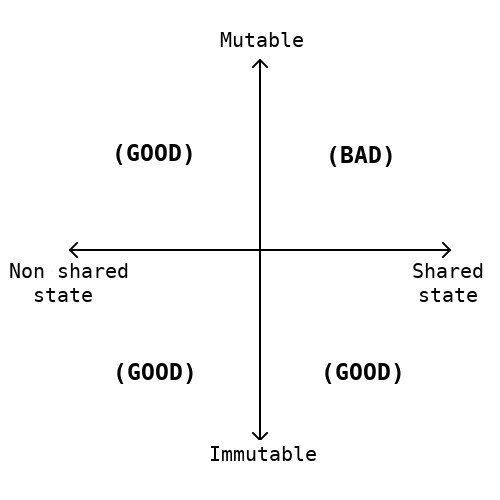

# 5. Nepromenljivost podataka (immutability)

> **Celina 1 — Temelji funkcionalnog programiranja** · Lekcija 5 od 8
>
> **Predznanje:** [Referencijalna transparentnost](04-referencijalna-transparentnost.md) (test zamene). Korisno: [Čiste funkcije](02-ciste-funkcije.md) (lokalna mutabilnost).

> [!NOTE]
> Originalni kurs nema posebno poglavlje o nepromenljivosti. Ova lekcija objedinjuje napomene iz originala (primer sa `append`, lokalna mutabilnost, primer [`mutable-is-unsafe-in-typescript.ts`](../../src/mutable-is-unsafe-in-typescript.ts) i autorovu mapu uma, u kojoj je nepromenljivost jedna od grana referencijalne transparentnosti), a većina objašnjenja i primera je nova.

## Šta ćemo naučiti?

- šta je nepromenljiva (immutable) vrednost i zašto mutacija ruši referencijalnu transparentnost
- problem **deljenih referenci** (aliasing)
- razliku između `const`, `readonly`, `ReadonlyArray`, `Readonly<T>`, `as const` i `Object.freeze`
- kako se podaci „menjaju“ bez mutacije: **kopija sa izmenom**
- zašto su promenljivi nizovi nebezbedni u TypeScript-u
- kada je mutacija ipak u redu

## Intuitivno objašnjenje

Pomislite na broj `5`. Kada izračunamo `5 + 1`, ne „pretvaramo peticu u šesticu“ — dobijamo **novu** vrednost `6`, a `5` ostaje `5`. Stringovi u JavaScript-u se ponašaju isto: `s.toUpperCase()` vraća novi string, a `s` ostaje nepromenjen.

Nepromenljivi podaci ponašaju se kao verzije dokumenta (ili komitovi u git-u): izmena pravi **novu verziju**, a ko god drži staru, i dalje vidi staru. Niko vam ne može „iza leđa“ promeniti vrednost koju ste dobili.

Objekti i nizovi u JavaScript-u, nažalost, nisu takvi: oni se mogu menjati na mestu. Zato nepromenljivost u TypeScript-u postižemo disciplinom — uz pomoć sistema tipova.

## Problem koji rešavamo: deljene reference

```ts
interface Product {
  name: string
  price: number
}

const products: Array<Product> = [
  { name: 'Knjiga', price: 1200 },
  { name: 'Olovka', price: 80 },
  { name: 'Sveska', price: 250 }
]

const cheapestFirst = (ps: Array<Product>): Array<Product> =>
  ps.sort((a, b) => a.price - b.price)

const applyDiscount = (ps: Array<Product>): Array<Product> => {
  for (const p of ps) {
    p.price = p.price * 0.9
  }
  return ps
}

const sorted = cheapestFirst(products)
const discounted = applyDiscount(products)

console.log(products[0]) // => { name: 'Olovka', price: 72 } — promenjeni su i redosled i cene!
console.log(sorted === products, discounted === products) // => true true
```

Sve tri promenljive pokazuju na **isti** niz sa **istim** objektima. Kod koji kasnije koristi `products` (na primer prikaz kataloga) sada vidi sortirane i snižene cene, iako nikada nije tražio ni jedno ni drugo. Da biste razumeli vrednost `products`, morate da znate sve što se sa njom desilo bilo gde u programu.

Ovo je tačno ono što smo videli u [prethodnoj lekciji](04-referencijalna-transparentnost.md): u originalnom primeru sa `append`, posle poziva `append(xs)` ne mogu da zamenim izraz `xs` njegovom početnom vrednošću `[1, 2, 3]`, jer je njegovu trenutnu vrednost promenio poziv funkcije `append`. **Referencijalna transparentnost može da podrazumeva korišćenje nepromenljivih struktura podataka.**

## Primer bez biblioteka: alati u TypeScript-u

### `const` nije nepromenljivost

```ts
const xs = [1, 2, 3]
xs.push(4) // dozvoljeno: `const` zabranjuje samo ponovnu dodelu (`xs = ...`)

console.log(xs) // => [ 1, 2, 3, 4 ]
```

`const` se odnosi na **ime** (ne može da pokazuje na drugu vrednost), a ne na **vrednost** (koja i dalje može da se menja).

### `readonly` i `ReadonlyArray`

```ts
interface Product {
  readonly name: string
  readonly price: number
}

const products: ReadonlyArray<Product> = [
  { name: 'Knjiga', price: 1200 },
  { name: 'Olovka', price: 80 }
]

// @ts-expect-error — svojstvo `price` je readonly
products[0].price = 0

// @ts-expect-error — ReadonlyArray nema metodu `push`
products.push({ name: 'Gumica', price: 30 })
```

Komentar `// @ts-expect-error` je direktiva TypeScript-a koja kaže: „u sledećem redu očekujem grešku“. Ovde je koristimo da pokažemo da kompajler **odbija** takav kod.

`ReadonlyArray<T>` (kraće: `readonly T[]`) nema nijednu metodu koja menja niz — ni `push`, ni `sort`, ni `reverse`, ni `splice` — pa vas kompajler sprečava da slučajno izmenite niz.

Još nekoliko alata:

- `Readonly<T>` — sva svojstva tipa `T` postaju `readonly`
- `as const` — literal postaje **duboko** readonly: `{ retries: 3, urls: ['a', 'b'] } as const` ima tip `{ readonly retries: 3; readonly urls: readonly ['a', 'b'] }`

### Zaštita je plitka

```ts
interface Order {
  readonly id: number
  readonly items: Array<string>
}

const order: Order = { id: 1, items: ['knjiga'] }

order.items.push('olovka') // dozvoljeno! `readonly` štiti svojstvo `items`, ne i sam niz

console.log(order.items) // => [ 'knjiga', 'olovka' ]
```

Rešenje je da i ugnežđeni tipovi budu nepromenljivi: `readonly items: ReadonlyArray<string>`. Isto važi i za `Readonly<T>`: deluje samo na prvom nivou.

### Zaštita postoji samo tokom kompajliranja

`readonly` postoji samo u sistemu tipova; u JavaScript-u koji se izvršava nema ga. Ako vam je potrebna zaštita i tokom izvršavanja, postoji `Object.freeze`, ali i ona je plitka:

```ts
const point = Object.freeze({ x: 1, y: 2 })

// @ts-expect-error — TypeScript zna da je rezultat `Readonly<{ x: number; y: number }>`
point.x = 10 // tokom izvršavanja u strict režimu: TypeError
```

U praksi se uglavnom oslanjamo na tipove (`readonly`, `ReadonlyArray`) i na disciplinu, jer je to besplatno tokom izvršavanja.

### Kako „menjati“ bez mutacije: kopija sa izmenom

Umesto da menjamo vrednost, pravimo **novu** vrednost koja se od stare razlikuje samo u onome što menjamo:

```ts
interface User {
  readonly name: string
  readonly age: number
}

const ana: User = { name: 'Ana', age: 30 }
const olderAna: User = { ...ana, age: ana.age + 1 }

console.log(ana) // => { name: 'Ana', age: 30 }
console.log(olderAna) // => { name: 'Ana', age: 31 }
```

Za nizove:

```ts
const xs: ReadonlyArray<number> = [3, 1, 2]

const added = [...xs, 4] // umesto push
const withoutFirst = xs.slice(1) // umesto shift
const doubled = xs.map((x) => x * 2) // umesto izmene u petlji
const sorted = [...xs].sort((a, b) => a - b) // sort menja niz, zato prvo kopija
const replaced = xs.map((x, i) => (i === 1 ? 10 : x)) // umesto xs[1] = 10

console.log(added, withoutFirst, doubled, sorted, replaced)
// => [ 3, 1, 2, 4 ] [ 1, 2 ] [ 6, 2, 4 ] [ 1, 2, 3 ] [ 3, 10, 2 ]
console.log(xs) // => [ 3, 1, 2 ]
```

Novije verzije JavaScript-a (ES2023, Node.js 20+) imaju i metode koje ne menjaju niz: `toSorted`, `toReversed`, `toSpliced` i `with`. (Podešavanja TypeScript-a u ovom repozitorijumu ih ne poznaju, pa ih primeri ne koriste.)

Ugnežđena izmena — svaki nivo na putu do izmene se kopira:

```ts
interface Address {
  readonly city: string
  readonly street: string
}

interface Customer {
  readonly name: string
  readonly address: Address
}

const c1: Customer = {
  name: 'Marko',
  address: { city: 'Beograd', street: 'Knez Mihailova 1' }
}

const c2: Customer = { ...c1, address: { ...c1.address, city: 'Novi Sad' } }

console.log(c1.address.city, c2.address.city) // => Beograd Novi Sad
```

Primetite da kopija nije „duboka“: delovi koji se ne menjaju **dele se** između stare i nove vrednosti. To je bezbedno upravo zato što ih niko ne menja, a čini kopiranje jeftinijim nego što izgleda. Za duboko ugnežđene izmene postoje _funkcionalne optike_ (lenses), na primer biblioteka [`monocle-ts`](https://github.com/gcanti/monocle-ts) istog autora; one su van opsega ovog kursa.

## Zamka: promenljivi nizovi nisu bezbedni u TypeScript-u

Sledeći primer je iz fajla [`mutable-is-unsafe-in-typescript.ts`](../../src/mutable-is-unsafe-in-typescript.ts) originalnog kursa:

```ts
const xs: Array<string> = ['a', 'b', 'b']
const ys: Array<string | undefined> = xs
ys.push(undefined)
xs.map((s) => s.trim()) // explosion at runtime
```

Kompajler ne prijavljuje nijednu grešku, a program pada tokom izvršavanja (`TypeError: Cannot read properties of undefined`). Zašto?

- TypeScript dozvoljava da se `Array<string>` dodeli promenljivoj tipa `Array<string | undefined>` — izgleda razumno, jer je svaki string i „string ili undefined“.
- Ali `xs` i `ys` su **isti niz**. Preko `ys` smo u njega ubacili `undefined`, a tip `xs` i dalje tvrdi da sadrži samo stringove.

Sa `ReadonlyArray` problem nestaje: dodela `const ys: ReadonlyArray<string | undefined> = xs` je potpuno bezbedna, jer kroz `ys` ne možemo ništa da ubacimo. Nepromenljivi tipovi nisu samo stvar stila — oni čine sistem tipova pouzdanijim.

## Mutacija je u redu — lokalno

To što je funkcija čista ne znači nužno da je mutabilnost zabranjena: lokalno je dozvoljena ako ne izlazi van granica implementacije ([lekcija 2](02-ciste-funkcije.md#lokalna-mutabilnost-je-dozvoljena)).



```ts
const range = (start: number, end: number): ReadonlyArray<number> => {
  const out: Array<number> = [] // lokalni, promenljivi niz...
  for (let i = start; i < end; i++) {
    out.push(i)
  }
  return out // ...koji spolja vidimo kao ReadonlyArray
}

console.log(range(1, 4)) // => [ 1, 2, 3 ]
```

Niz `out` menjamo dok ga gradimo, ali ga vraćamo kao `ReadonlyArray`, pa ga niko izvan funkcije ne može promeniti.

## Formalna definicija

- Vrednost je **nepromenljiva** (immutable) ako se posle nastanka ne može promeniti.
- Struktura podataka je **perzistentna** (persistent) ako „izmena“ proizvodi novu verziju, a prethodna verzija ostaje dostupna i nepromenjena.

Veza sa referencijalnom transparentnošću: ako se vrednosti ne menjaju, ime uvek označava istu vrednost, pa je zamena imena vrednošću (i obrnuto) uvek bezbedna.

## Primer sa fp-ts

Funkcije u `fp-ts`-u nikada ne menjaju svoj ulaz, a za većinu struktura postoje readonly moduli (`ReadonlyArray`, `ReadonlyRecord`, `ReadonlyMap`…). Modul `fp-ts/ReadonlyArray` sadrži operacije koje ne menjaju niz:

```ts
import { pipe } from 'fp-ts/function'
import * as RA from 'fp-ts/ReadonlyArray'

const xs: ReadonlyArray<number> = [1, 2, 3]

const ys = pipe(xs, RA.append(4))
const zs = pipe(xs, RA.prepend(0))
const ws = pipe(xs, RA.reverse)

console.log(ys, zs, ws) // => [ 1, 2, 3, 4 ] [ 0, 1, 2, 3 ] [ 3, 2, 1 ]
console.log(xs) // => [ 1, 2, 3 ]
```

(Podsetnik: `pipe(x, f)` znači `f(x)`; detaljno u [lekciji 7](07-pipe-i-flow.md).)

I biblioteka Effect sadrži nepromenljive strukture podataka, na primer `Chunk`, `HashMap` i `HashSet`.

## Najčešće greške

- **„`const` znači nepromenljivo.“** `const` zabranjuje samo ponovnu dodelu imena.
- **„`readonly` štiti ceo objekat.“** `readonly` i `Readonly<T>` su plitki; ugnežđeni nizovi i objekti moraju imati sopstvene readonly tipove.
- **„`readonly` važi i tokom izvršavanja.“** Postoji samo u tipovima.
- **„Metode nizova vraćaju novi niz.“** Neke da (`map`, `filter`, `slice`, `concat`), a neke menjaju postojeći (`sort`, `reverse`, `splice`, `push`, `pop`, `shift`, `unshift`, `fill`).
- **„Spread pravi potpunu kopiju.“** `const c3 = { ...c1 }` je plitka kopija: `c3.address` je isti objekat kao `c1.address`. To je u redu samo dok niko ne menja `address`. (Zato je u primeru sa adresom kopiran i nivo `address`.)
- **„Nepromenljivost znači da nijedna promenljiva ne sme da se menja.“** Lokalna mutacija unutar funkcije je u redu.

## Vežba

1. Prepravite `cheapestFirst` i `applyDiscount` iz odeljka [Problem koji rešavamo](#problem-koji-rešavamo-deljene-reference) tako da ne menjaju ulaz. Promenite i tipove tako da kompajler spreči mutaciju.
2. Napišite funkciju `updateQuantity` koja menja količinu jednog proizvoda u korpi, bez mutacije:

```ts
interface CartItem {
  readonly productId: string
  readonly quantity: number
}

interface Cart {
  readonly items: ReadonlyArray<CartItem>
}

declare const updateQuantity: (
  cart: Cart,
  productId: string,
  quantity: number
) => Cart
```

<details>
<summary>Rešenje</summary>

1.

```ts
interface Product {
  readonly name: string
  readonly price: number
}

const cheapestFirst = (ps: ReadonlyArray<Product>): ReadonlyArray<Product> =>
  [...ps].sort((a, b) => a.price - b.price)

const applyDiscount = (ps: ReadonlyArray<Product>): ReadonlyArray<Product> =>
  ps.map((p) => ({ ...p, price: p.price * 0.9 }))

const products: ReadonlyArray<Product> = [
  { name: 'Knjiga', price: 1200 },
  { name: 'Olovka', price: 80 },
  { name: 'Sveska', price: 250 }
]

console.log(applyDiscount(cheapestFirst(products))[0]) // => { name: 'Olovka', price: 72 }
console.log(products[0]) // => { name: 'Knjiga', price: 1200 }
```

2.

```ts
interface CartItem {
  readonly productId: string
  readonly quantity: number
}

interface Cart {
  readonly items: ReadonlyArray<CartItem>
}

const updateQuantity = (
  cart: Cart,
  productId: string,
  quantity: number
): Cart => ({
  ...cart,
  items: cart.items.map((item) =>
    item.productId === productId ? { ...item, quantity } : item
  )
})

const cart: Cart = {
  items: [
    { productId: 'knjiga', quantity: 1 },
    { productId: 'olovka', quantity: 3 }
  ]
}

console.log(updateQuantity(cart, 'olovka', 5).items[1]) // => { productId: 'olovka', quantity: 5 }
console.log(cart.items[1]) // => { productId: 'olovka', quantity: 3 }
```

</details>

## Sažetak

- Nepromenljiva vrednost se ne menja; „izmena“ pravi **novu vrednost**.
- Mutacija preko **deljenih referenci** menja podatke i onima koji to nisu tražili, i ruši referencijalnu transparentnost.
- `const` ≠ nepromenljivost. Koristite `readonly`, `ReadonlyArray` i `as const`, imajući na umu da su `readonly` i `Readonly<T>` plitki i da postoje samo u tipovima.
- „Menjamo“ **kopijom sa izmenom**: spread (`{ ...o }`, `[...xs]`), `map`, `filter`, `slice`.
- Promenljivi nizovi čine sistem tipova TypeScript-a nepouzdanim; `ReadonlyArray` to ispravlja.
- Lokalna mutacija je u redu dok ne izlazi van funkcije.

## Izvori

- Originalni prevod: primer sa `append` iz odeljka [Referencijalna transparentnost](../original/02-dva-stuba-funkcionalnog-programiranja.md#referencijalna-transparentnost); lokalna mutabilnost i ilustracija iz poglavlja [Čiste funkcije i parcijalne funkcije](../original/07-ciste-i-parcijalne-funkcije.md); primer [`mutable-is-unsafe-in-typescript.ts`](../../src/mutable-is-unsafe-in-typescript.ts); [mapa uma](../original/index.md#mapa-uma-originalnog-kursa) (nepromenljivost kao grana referencijalne transparentnosti, funkcionalne optike).
- Novo u ovoj verziji: sva objašnjenja alata TypeScript-a, primeri sa proizvodima, korisnicima, korpom i adresom, objašnjenje zamke sa nizovima, formalne definicije, primer sa `fp-ts/ReadonlyArray`, napomena o Effect-u, najčešće greške i vežba.

## Sledeća lekcija

Prvi stub — referencijalnu transparentnost — sada poznajemo zajedno sa njenim preduslovima. U [lekciji 6 — Kompozicija funkcija](06-kompozicija-funkcija.md) prelazimo na drugi stub: kako da od malih funkcija gradimo velike.
