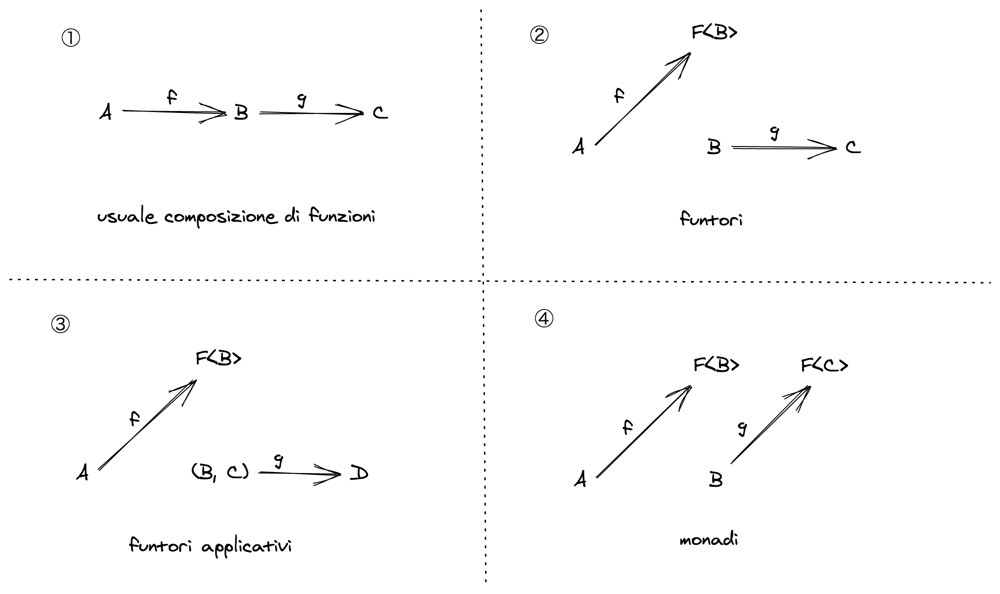

# 6. Kompozicija funkcija

> **Celina 1 — Temelji funkcionalnog programiranja** · Lekcija 6 od 8
>
> **Predznanje:** [Čiste funkcije](02-ciste-funkcije.md) (domen i kodomen funkcije), osnovni generici u TypeScript-u (`<A, B>`).

## Šta ćemo naučiti?

- šta je **kompozicija funkcija** i kada se dve funkcije mogu komponovati
- kako da sami napišemo funkciju `compose`
- **funkciju identiteta** i dva zakona kompozicije: identitet i asocijativnost
- **obrazac kombinatora**: model, primitive i kombinatori
- da se ne komponuju sve funkcije — i kako nas to vodi kroz ostatak kursa

## Intuitivno objašnjenje

U Unix terminalu možete da napišete:

```sh
cat access.log | grep 404 | wc -l
```

Tri mala programa, od kojih svaki radi jednu stvar: `cat` čita fajl, `grep` zadržava redove sa `404`, `wc -l` broji redove. Spojeni, prebrojavaju greške u logu — iako nijedan od njih to sam ne ume. Spajanje radi zato što izlaz jednog programa ima isti oblik (tekst) kao ulaz sledećeg.

Kompozicija funkcija je ista ideja: izlaz jedne funkcije postaje ulaz druge. Uslov je da se **tipovi poklapaju**.

Osnovni obrazac funkcionalnog programiranja je _kompozabilnost_, odnosno građenje malih jedinica koje rade nešto specifično i koje se mogu međusobno kombinovati kako bi se dobile veće i složenije celine. Idući „od manjeg ka većem“, možemo da zamislimo:

- kompoziciju dve jednostavne vrednosti (kao što su dva broja ili dva stringa)
- ili kompoziciju funkcija
- ili čak kompoziciju čitavih programa

U ovom poslednjem slučaju možemo da govorimo o „modularnom programiranju“:

> By modular programming I mean the process of building large programs by gluing together smaller programs - Simon Peyton Jones

(Pod modularnim programiranjem podrazumevam građenje velikih programa „lepljenjem“ manjih programa.)

## Problem koji rešavamo

Probleme rešavamo razlaganjem:

> And how do we solve problems? We decompose bigger problems into smaller problems. If the smaller problems are still too big, we decompose them further, and so on. Finally, we write code that solves all the small problems. And then comes the essence of programming: we compose those pieces of code to create solutions to larger problems. Decomposition wouldn't make sense if we weren't able to put the pieces back together. - Bartosz Milewski

Razlaganje ima smisla samo ako delove možemo ponovo da sastavimo. Uzmimo funkciju koja od korisničkog unosa pravi oznaku cene:

```ts
const priceLabel = (input: string): string => {
  const amount = Number(input.trim().replace(',', '.'))
  const withVat = amount * 1.2
  return `${withVat.toFixed(2)} RSD`
}

console.log(priceLabel(' 12,5 ')) // => 15.00 RSD
```

Radi, ali je monolitna: parsiranje iznosa, obračun PDV-a i formatiranje ne mogu da se koriste odvojeno ni da se testiraju odvojeno. Razložimo je:

```ts
const parseAmount = (s: string): number => Number(s.trim().replace(',', '.'))
const addVat = (n: number): number => n * 1.2
const formatRSD = (n: number): string => `${n.toFixed(2)} RSD`

console.log(formatRSD(addVat(parseAmount(' 12,5 ')))) // => 15.00 RSD
```

Sada imamo tri funkcije koje se mogu koristiti i testirati pojedinačno. Ostaje pitanje kako da ih **spojimo u novu funkciju** — bez pisanja nove procedure svaki put.

## Primer bez biblioteka

Napišimo funkciju koja od dve funkcije pravi treću:

```ts
const compose = <A, B, C>(f: (b: B) => C, g: (a: A) => B) => (a: A): C =>
  f(g(a))

const parseAmount = (s: string): number => Number(s.trim().replace(',', '.'))
const addVat = (n: number): number => n * 1.2
const formatRSD = (n: number): string => `${n.toFixed(2)} RSD`

const priceLabel = compose(formatRSD, compose(addVat, parseAmount))

console.log(priceLabel(' 12,5 ')) // => 15.00 RSD
```

Obratite pažnju na redosled: `compose(f, g)` **prvo** primenjuje `g`, a zatim `f` — kao u matematičkom zapisu `f(g(x))`.

Generički parametri `A`, `B` i `C` izražavaju uslov kompozicije: `g` vraća `B`, a `f` prima `B`. Ako se tipovi ne poklapaju, TypeScript odbija kompoziciju:

```ts
const compose = <A, B, C>(f: (b: B) => C, g: (a: A) => B) => (a: A): C =>
  f(g(a))

const length = (s: string): number => s.length
const double = (n: number): number => n * 2

const doubleLength = compose(double, length) // (a: string) => number

// @ts-expect-error — `length` očekuje string, a `double` vraća number
const wrong = compose(length, double)
```

(Komentar `// @ts-expect-error` kaže TypeScript-u da u sledećem redu očekujemo grešku; ovde nam služi da pokažemo da kompajler takav kod odbija.)

## Formalna definicija

Funkcije se, naime, komponuju:

**Definicija**. Neka su `f: Y ⟶ Z` i `g: X ⟶ Y` dve funkcije; tada se funkcija `h: X ⟶ Z` definisana sa

```text
h(x) = f(g(x))
```

naziva _kompozicija_ funkcija `f` i `g` i piše se `h = f ∘ g`.

Primetite: da bi dve funkcije `f` i `g` mogle da se komponuju, domen funkcije `f` mora da se poklapa sa kodomenom funkcije `g`.

### Zakoni kompozicije

**Funkcija identiteta** vraća svoj argument nepromenjen:

```ts nocheck
const identity = <A>(a: A): A => a
```

Kompozicija zadovoljava dva zakona, za sve funkcije `f`, `g`, `h` odgovarajućih tipova:

- **identitet**: `f ∘ identity = f` i `identity ∘ f = f`
- **asocijativnost**: `h ∘ (g ∘ f) = (h ∘ g) ∘ f`

Proverimo ih na primeru:

```ts
const compose = <A, B, C>(f: (b: B) => C, g: (a: A) => B) => (a: A): C =>
  f(g(a))
const identity = <A>(a: A): A => a

const inc = (n: number): number => n + 1
const double = (n: number): number => n * 2
const square = (n: number): number => n * n

// `identity` je generička; ovde nam treba identitet za brojeve
const id: (n: number) => number = identity

// identitet
console.log(compose(inc, id)(5), compose(id, inc)(5), inc(5)) // => 6 6 6

// asocijativnost
const left = compose(square, compose(double, inc))
const right = compose(compose(square, double), inc)
console.log(left(3), right(3)) // => 64 64

// ali NE i komutativnost: redosled je bitan
console.log(compose(double, inc)(3), compose(inc, double)(3)) // => 8 7
```

Zašto su ovi zakoni važni?

- Zbog **asocijativnosti** zagrade nisu bitne, pa možemo da pišemo jednostavno `square ∘ double ∘ inc`. Na tome počivaju `pipe` i `flow` iz [sledeće lekcije](07-pipe-i-flow.md): dugačak niz koraka možemo da delimo i grupišemo kako hoćemo.
- Zbog **identiteta** postoji „neutralni“ korak koji ništa ne menja — kao `0` za sabiranje. To je korisno, na primer, kao početna vrednost kada komponujemo niz funkcija (videti vežbu).

Ova dva zakona nisu slučajna. Matematičari su upravo njih (zajedno sa samom operacijom kompozicije) uzeli za definiciju pojma **kategorije**, jer _„categories capture the essence of composition“_ (kategorije obuhvataju suštinu kompozicije). Kategorijama se bavimo u Celini 4; radoznali mogu odmah da pogledaju poglavlje [Teorija kategorija](../original/10-teorija-kategorija.md) originalnog kursa.

## Obrazac kombinatora

Pogledajmo u praksi kako je moguće približiti se kompozicionom stilu programiranja korišćenjem onoga što se naziva kombinatorima.

Termin **kombinator** odnosi se na [combinator pattern](https://wiki.haskell.org/Combinator):

> A style of organizing libraries centered around the idea of combining things. Usually there is some type `T`, some "primitive" values of type `T`, and some "combinators" which can combine values of type `T` in various ways to build up more complex values of type `T`

(Stil organizovanja biblioteka zasnovan na ideji kombinovanja: postoji neki tip `T`, nekoliko „primitivnih“ vrednosti tipa `T` i „kombinatori“ koji vrednosti tipa `T` kombinuju u složenije vrednosti tipa `T`.)

Pojam kombinatora je prilično neodređen i može da se javi u različitim oblicima, ali njegov najjednostavniji oblik je sledeći:

```text
combinator: Thing -> Thing
```

**Primer**. Funkciju `double` možemo da posmatramo kao kombinator brojeva.

Svrha kombinatora je da pravi nove „stvari“ od prethodno definisanih „stvari“. Primetite da se rezultat kombinatora ponovo može proslediti kao ulaz, pa se tako dobija kombinatorna eksplozija mogućnosti, što ovaj obrazac čini veoma moćnim:

```ts
const double = (n: number): number => n * 2

console.log(double(double(double(2)))) // => 16
```

Stoga je opšti dizajn koji često možete da sretnete u funkcionalnom modulu sledeći:

- model za `T`
- skup jednostavnih „primitiva“ tipa `T`
- skup kombinatora za kombinovanje primitiva u složenije strukture

### Primer: politika ponavljanja (retry)

Kada mrežni zahtev ne uspe, često želimo da ga ponovimo — ali koliko puta i sa kolikom pauzom? Odgovor na to pitanje zovemo **politikom ponavljanja** (retry policy). Sledeći modul je skraćena verzija demoa [`01_retry.ts`](../../src/01_retry.ts) iz originalnog kursa:

```ts
// -------------------------------------------------------------
// model
// -------------------------------------------------------------

interface RetryStatus {
  /** redni broj pokušaja, `0` je prvi pokušaj */
  readonly iterNumber: number
  /** pauza pre prethodnog pokušaja; `undefined` na početku */
  readonly previousDelay: number | undefined
}

/** za dati status vraća pauzu u milisekundama, ili `undefined` ako treba odustati */
type RetryPolicy = (status: RetryStatus) => number | undefined

// -------------------------------------------------------------
// primitive
// -------------------------------------------------------------

/** ista pauza, neograničen broj pokušaja */
const constantDelay = (delay: number): RetryPolicy => () => delay

/** bez pauze, ali najviše `i` ponavljanja */
const limitRetries = (i: number): RetryPolicy => (status) =>
  status.iterNumber >= i ? undefined : 0

/** pauza se udvostručuje sa svakim pokušajem */
const exponentialBackoff = (delay: number): RetryPolicy => (status) =>
  delay * Math.pow(2, status.iterNumber)

// -------------------------------------------------------------
// kombinatori
// -------------------------------------------------------------

/** ograničava pauzu odozgo */
const capDelay = (maxDelay: number) => (policy: RetryPolicy): RetryPolicy => (
  status
) => {
  const delay = policy(status)
  return delay === undefined ? undefined : Math.min(maxDelay, delay)
}

/** spaja dve politike: odustaje ako bilo koja odustaje, inače uzima dužu pauzu */
const concat = (second: RetryPolicy) => (first: RetryPolicy): RetryPolicy => (
  status
) => {
  const delay1 = first(status)
  const delay2 = second(status)
  if (delay1 !== undefined && delay2 !== undefined) {
    return Math.max(delay1, delay2)
  }
  return undefined
}

// -------------------------------------------------------------
// primer upotrebe
// -------------------------------------------------------------

const myPolicy = capDelay(2000)(
  concat(limitRetries(5))(concat(exponentialBackoff(200))(constantDelay(300)))
)

const delays = [0, 1, 2, 3, 4, 5].map((iterNumber) =>
  myPolicy({ iterNumber, previousDelay: undefined })
)

console.log(delays) // => [ 300, 400, 800, 1600, 2000, undefined ]
```

Sa samo tri primitive i dva kombinatora uspeli smo da izrazimo prilično složenu politiku: „najmanje 300 ms, eksponencijalno raste od 200 ms, najviše 2 sekunde, najviše 5 ponavljanja“ (posle prvog pokušaja). Zamislite kako, dodavanjem makar samo jedne nove primitive (ili novog kombinatora) onima koji su već definisani, izražajne mogućnosti rastu eksponencijalno.

Primetite i da je izraz koji gradi `myPolicy` teško čitati: čita se iznutra ka spolja. U [sledećoj lekciji](07-pipe-i-flow.md) videćemo kako ga `pipe` pretvara u čitljiv niz koraka (tako je napisan i u originalnom demou):

```ts nocheck
const myPolicy = pipe(
  constantDelay(300),
  concat(exponentialBackoff(200)),
  concat(limitRetries(5)),
  capDelay(2000)
)
```

Od dva kombinatora posebno treba pomenuti `concat`, jer ga je moguće povezati sa jednom važnom apstrakcijom funkcionalnog programiranja: **polugrupama** (Celina 3).

## Ne komponuju se sve funkcije

Pokušajmo da udvostručimo prvi element niza. Prvi element praznog niza ne postoji, pa funkcija `head` vraća `number | undefined`:

```ts
const compose = <A, B, C>(f: (b: B) => C, g: (a: A) => B) => (a: A): C =>
  f(g(a))

const head = (as: ReadonlyArray<number>): number | undefined =>
  as.length > 0 ? as[0] : undefined
const double = (n: number): number => n * 2

// @ts-expect-error — `head` vraća `number | undefined`, a `double` očekuje `number`
const doubleHead = compose(double, head)
```

Kodomen funkcije `head` se ne poklapa sa domenom funkcije `double`. Šta onda da radimo? Da odustanemo?

Ovo je **centralni problem kompozicije** kojim se bavi ostatak kursa. Originalni kurs ga rešava postepeno, i ovo je mapa puta („spoiler“ iz originala), gde `F<B>` znači „vrednost tipa `B` u nekom kontekstu `F`“ — na primer „možda `B`“, „lista `B`-ova“ ili „`B` koje stiže kasnije“:

- da bismo komponovali `f: (a: A) => B` sa `g: (b: B) => C`, potrebna nam je samo uobičajena kompozicija funkcija (ova lekcija)
- da bismo komponovali `f: (a: A) => F<B>` sa `g: (b: B) => C`, potrebna nam je instanca **funktora** za `F` (Celina 4)
- da bismo komponovali `f: (a: A) => F<B>` sa `g: (b: B, c: C) => D`, potrebna nam je instanca **aplikativnog funktora** za `F` (Celina 4)
- da bismo komponovali `f: (a: A) => F<B>` sa `g: (b: B) => F<C>`, potrebna nam je instanca **monade** za `F` (Celina 5)



(Natpisi na slici su na italijanskom: ① uobičajena kompozicija funkcija, ② funktori, ③ aplikativni funktori, ④ monade.)

Naš problem sa `head` i `double` odgovara situaciji ②. Prvi korak ka rešenju je da razumemo zašto `head` uopšte vraća `undefined` — o tome govori [lekcija 8](08-totalne-i-parcijalne-funkcije.md).

## Primer sa fp-ts

Modul `fp-ts/function` sadrži funkciju `identity` i funkciju `flow`, koja komponuje funkcije **sleva nadesno**: `flow(g, f)` je isto što i `compose(f, g)`.

```ts
import { flow, identity } from 'fp-ts/function'

const inc = (n: number): number => n + 1
const double = (n: number): number => n * 2

const incThenDouble = flow(inc, double) // isto što i compose(double, inc)

console.log(incThenDouble(3)) // => 8
console.log(flow(inc, identity)(3)) // => 4
```

Funkciji `flow` (i njenoj sestri `pipe`) posvećena je sledeća lekcija.

## Najčešće greške

- **Pogrešan redosled.** `f ∘ g` (odnosno `compose(f, g)`) **prvo** primenjuje `g`. `flow(g, f)` radi isto, ali se čita sleva nadesno.
- **Mešanje asocijativnosti i komutativnosti.** Zagrade nisu bitne (`h ∘ (g ∘ f) = (h ∘ g) ∘ f`), ali redosled jeste (`double ∘ inc ≠ inc ∘ double`).
- **„Popravljanje“ nekompatibilnih tipova pomoću `as`.** Ako se tipovi ne poklapaju, kompozicija nema smisla; kastovanje samo sakriva grešku do izvršavanja.
- **Kompozicija funkcija sa više parametara.** `compose` radi sa funkcijama jednog parametra. Kako da funkciju sa više parametara prilagodimo videćemo u [sledećoj lekciji](07-pipe-i-flow.md#currying-i-data-last-funkcije) (currying).

## Vežba

1. Od funkcija `trim`, `toLowerCase` i `spacesToDashes` (zamenjuje razmake crticama) napravite funkciju `slugify` pomoću `compose`, tako da `slugify('  Zdravo Svete ')` vrati `'zdravo-svete'`.
2. Pronađite primer dve funkcije `f` i `g` tipa `(n: number) => number` za koje `compose(f, g)` i `compose(g, f)` daju različit rezultat, i primer za koji daju isti.
3. ★ Napišite funkciju `composeAll` koja komponuje niz funkcija tipa `(a: A) => A`, tako da `composeAll([f, g, h])` bude `f ∘ g ∘ h`. Šta treba da vrati za prazan niz?

<details>
<summary>Rešenje</summary>

1.

```ts
const compose = <A, B, C>(f: (b: B) => C, g: (a: A) => B) => (a: A): C =>
  f(g(a))

const trim = (s: string): string => s.trim()
const toLowerCase = (s: string): string => s.toLowerCase()
const spacesToDashes = (s: string): string => s.split(' ').join('-')

const slugify = compose(spacesToDashes, compose(toLowerCase, trim))

console.log(slugify('  Zdravo Svete ')) // => zdravo-svete
```

2. Različit rezultat: `double` i `inc` (za ulaz `3` dobija se `8`, odnosno `7`). Isti rezultat: `double` i `triple` (`n => n * 3`), jer je `2 · (3n) = 3 · (2n)`. Oprez: `double` i `square` **nisu** primer, jer je `2n² ≠ (2n)² = 4n²`. Komutativnost treba proveriti, a ne pretpostaviti.

3. Prazan niz treba da vrati `identity` — „korak koji ništa ne menja“:

```ts
const compose = <A, B, C>(f: (b: B) => C, g: (a: A) => B) => (a: A): C =>
  f(g(a))
const identity = <A>(a: A): A => a

const composeAll = <A>(fs: ReadonlyArray<(a: A) => A>): ((a: A) => A) =>
  fs.reduce((acc, f) => compose(acc, f), identity)

const inc = (n: number): number => n + 1
const double = (n: number): number => n * 2

console.log(composeAll([inc, double])(3)) // => 7 (inc(double(3)))
console.log(composeAll<number>([])(3)) // => 3
```

Upravo zbog zakona identiteta i asocijativnosti ovo radi za bilo koji niz. U Celini 3 videćemo da funkcije tipa `(a: A) => A`, zajedno sa kompozicijom i funkcijom `identity`, čine **monoid**.

</details>

## Sažetak

- **Kompozicija** `f ∘ g` je funkcija `x ↦ f(g(x))`; moguća je kada se kodomen funkcije `g` poklapa sa domenom funkcije `f`.
- Kompozicija je **asocijativna** i ima **neutralni element** (`identity`), ali nije komutativna.
- **Obrazac kombinatora**: model, primitive i kombinatori koji od vrednosti tipa `T` prave nove vrednosti tipa `T`.
- Ne komponuju se sve funkcije: kada funkcija vraća vrednost „u kontekstu“ (`F<B>`), potrebni su funktori, aplikativni funktori i monade.

## Izvori

- Originalni prevod: odeljak [Kompozicija](../original/02-dva-stuba-funkcionalnog-programiranja.md#kompozicija) (kompozabilnost, Simon Peyton Jones, kombinatori, demo `01_retry.ts`); definicija kompozicije iz poglavlja [Čiste funkcije i parcijalne funkcije](../original/07-ciste-i-parcijalne-funkcije.md); citat Bartosza Milewskog, zakoni, problem `head`/`double` i „spoiler“ iz poglavlja [Teorija kategorija](../original/10-teorija-kategorija.md); monoid endomorfizama iz poglavlja [Monoidi](../original/06-monoidi.md).
- Novo u ovoj verziji: Unix analogija, primer sa oznakom cene, implementacija `compose`, demonstracija zakona u kodu, skraćena verzija retry modula sa ispisom pauza, varijanta problema sa `number | undefined`, najčešće greške i vežba.

## Sledeća lekcija

Ugnežđeni pozivi poput `compose(formatRSD, compose(addVat, parseAmount))` brzo postaju nečitljivi. U [lekciji 7 — `pipe` i `flow`](07-pipe-i-flow.md) učimo da kompoziciju pišemo kao niz koraka sleva nadesno i kako da funkcije prilagodimo tom stilu.
