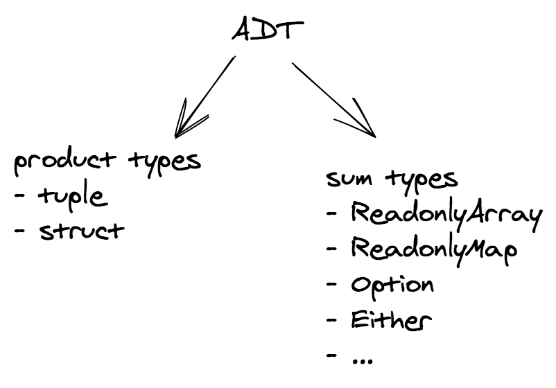

# 1. Product tipovi (tipovi proizvoda)

> **Celina 2 — Modelovanje podataka i grešaka** · Lekcija 1 od 7
>
> **Predznanje:** [Celina 1](../01-osnove/index.md), posebno [Nepromenljivost podataka](../01-osnove/05-nepromenljivost.md) (`readonly`). Iz TypeScript-a: `interface`, `type`, torke (tuples) i literal tipovi (`'AM' | 'PM'`).

## Šta ćemo naučiti?

- šta su **algebarski tipovi podataka** i koje su njihove dve osnovne familije
- šta je **tip proizvoda**: torke i strukture
- šta je **kardinalnost** tipa i zašto se ovi tipovi zovu baš „proizvodi“
- kako da kardinalnošću proverimo da li tip dozvoljava nevažeća stanja
- kada je tip proizvoda pravi izbor — i kada nije

## Intuitivno objašnjenje

Polje na šahovskoj tabli određeno je kolonom (`a`–`h`) **i** redom (`1`–`8`). Kolona i red se biraju nezavisno, pa polja ima `8 × 8 = 64`.

Tip proizvoda je upravo to: vrednost se sastoji od više delova **istovremeno** — kolona _i_ red, ime _i_ godine, sat _i_ deo dana. Broj mogućih vrednosti je **proizvod** broja mogućnosti za svaki deo, odakle i ime.

## Algebarski tipovi podataka

Dobar prvi korak pri izgradnji nove aplikacije jeste definisanje njenog domenskog modela. TypeScript nudi mnogo alata koji pomažu u tom zadatku. **Algebarski tipovi podataka** (Algebraic Data Types, skraćeno ADT) jedan su od tih alata.

> In computer programming, especially functional programming and type theory, an algebraic data type is a kind of composite type, i.e., a type formed by combining other types.

(U programiranju, posebno u funkcionalnom programiranju i teoriji tipova, algebarski tip podataka je složeni tip, odnosno tip nastao kombinovanjem drugih tipova.)

Dve česte familije algebarskih tipova podataka su: **tipovi proizvoda** (product types) i **tipovi sume** (sum types).



Počnimo od onih poznatijih: tipova proizvoda. Tipovima sume posvećena je [sledeća lekcija](02-sum-tipovi.md).

## Problem koji rešavamo

Treba nam tip za vreme na satu sa dvanaestočasovnim prikazom, na primer „3 PM“. Prvi pokušaj:

```ts
interface Clock {
  readonly hour: number
  readonly period: string
}

// sve ovo se kompajlira, a nijedna vrednost nema smisla
const a: Clock = { hour: 25, period: 'PM' }
const b: Clock = { hour: 3.5, period: 'AM' }
const c: Clock = { hour: 3, period: 'popodne' }
```

Tip dozvoljava mnogo više vrednosti nego što na satu postoji stanja. Svaka suvišna vrednost je **nevažeće stanje** koje neko mora da proverava tokom izvršavanja — ili da zaboravi da proveri.

Ako umesto širokih tipova `number` i `string` upotrebimo literal tipove, tip opisuje tačno ono što postoji:

```ts
type Hour = 1 | 2 | 3 | 4 | 5 | 6 | 7 | 8 | 9 | 10 | 11 | 12
type Period = 'AM' | 'PM'

interface Clock {
  readonly hour: Hour
  readonly period: Period
}

const ok: Clock = { hour: 3, period: 'PM' }

// @ts-expect-error — 25 nije Hour
const wrong: Clock = { hour: 25, period: 'PM' }
```

(Komentar `// @ts-expect-error` kaže TypeScript-u da u sledećem redu očekujemo grešku; ovde nam služi da pokažemo da kompajler takvu vrednost odbija.)

Koliko sada ima mogućih vrednosti? Odgovor daje pojam **kardinalnosti**, i on je glavni alat ove celine: ako tip ima više vrednosti nego što domen ima važećih stanja, nevažeća stanja su moguća.

## Primer bez biblioteka

Tip proizvoda je kolekcija tipova T<sub>i</sub> indeksiranih skupom `I`.

Dva česta člana ove familije su `n`-torke, gde je `I` interval prirodnih brojeva:

```ts
type Tuple1 = [string] // I = [0]
type Tuple2 = [string, number] // I = [0, 1]
type Tuple3 = [string, number, boolean] // I = [0, 1, 2]

// Accessing by index
type Fst = Tuple2[0] // string
type Snd = Tuple2[1] // number
```

i struct-ovi (strukture), gde je `I` skup labela:

```ts
// I = {"name", "age"}
interface Person {
  name: string
  age: number
}

// Accessing by label
type Name = Person['name'] // string
type Age = Person['age'] // number
```

Torka i struktura nose istu vrstu informacije; razlika je samo u tome da li delovima pristupamo po poziciji (`pair[0]`) ili po imenu (`person.name`). U kodu ovog kursa svojstva su, naravno, `readonly`.

Tipovi proizvoda mogu biti **polimorfni** (imati tipski parametar):

```ts
//                ↓ type parameter
type HttpResponse<A> = {
  readonly code: number
  readonly body: A
}

const response: HttpResponse<ReadonlyArray<string>> = {
  code: 200,
  body: ['Ana', 'Marko']
}
```

## Formalna definicija: kardinalnost

### Odakle naziv „tipovi proizvoda“?

Ako sa `C(A)` označimo broj stanovnika tipa `A`, što nazivamo **kardinalnost**, onda važi sledeća jednakost:

```text
C([A, B]) = C(A) * C(B)
```

> kardinalnost proizvoda je proizvod kardinalnosti

**Primer**

Tip `null` ima kardinalnost `1` jer ima samo jednog stanovnika: `null`.

**Primer**

Tip `boolean` ima kardinalnost `2` jer ima dva stanovnika: `true` i `false`.

**Primer**

```ts
type Hour = 1 | 2 | 3 | 4 | 5 | 6 | 7 | 8 | 9 | 10 | 11 | 12
type Period = 'AM' | 'PM'
type Clock = readonly [Hour, Period]
```

Tip `Hour` ima `12` stanovnika. Tip `Period` ima `2` stanovnika. Tip `Clock` ima `12 * 2 = 24` stanovnika.

**Kviz**. Koliko stanovnika ima sledeći tip `Clock`?

```ts
// same as before
type Hour = 1 | 2 | 3 | 4 | 5 | 6 | 7 | 8 | 9 | 10 | 11 | 12
// same as before
type Period = 'AM' | 'PM'

type Clock = {
  readonly hour: Hour
  readonly period: Period
}
```

<details>
<summary>Odgovor</summary>

Takođe `24`. Labele ne menjaju broj mogućih vrednosti: struktura `{ hour, period }` i torka `[Hour, Period]` nose istu informaciju, samo joj se pristupa na drugi način. Za dva tipa sa istim brojem vrednosti, između kojih postoji prevođenje u oba smera bez gubitka informacije, kažemo da su **izomorfni**.

</details>

Nekoliko posledica formule koje je korisno zapamtiti:

- tip sa **jednim** stanovnikom (`null`, `undefined`, literal `'x'`) ne menja kardinalnost proizvoda: `C([A, null]) = C(A) * 1`
- tip **bez** stanovnika, `never`, „poništava“ proizvod: `C([A, never]) = C(A) * 0 = 0` — takvu vrednost nije moguće napraviti
- tipovi poput `string` i `number` imaju ogroman broj stanovnika, pa za praktične potrebe njihovu kardinalnost smatramo beskonačnom

Za prvi pokušaj sa satom (`{ hour: number; period: string }`) to znači: praktično beskonačno mnogo vrednosti, od kojih je važeće samo njih 24.

## Kada je tip proizvoda pravi izbor?

Kad god su njegove komponente **nezavisne**.

```ts nocheck
type Clock = readonly [Hour, Period]
```

Ovde su `Hour` i `Period` nezavisni, odnosno vrednost `Hour` ne utiče na vrednost `Period` i obrnuto; svi parovi su legalni i imaju smisla.

Šta kada komponente **nisu** nezavisne? Pogledajmo čest model stanja učitavanja podataka:

```ts
interface RemoteData {
  readonly isLoading: boolean
  readonly data: string | undefined
  readonly error: string | undefined
}

// kompajlira se, a ne znači ništa: učitava se, a već ima i podatke i grešku?
const nonsense: RemoteData = {
  isLoading: true,
  data: 'rezultat',
  error: 'greška'
}
```

Važeća stanja su samo tri: „učitava se“, „uspeh sa podacima“ i „greška sa porukom“. Ali tip je proizvod tri komponente koje **zavise** jedna od druge, pa dozvoljava i sve besmislene kombinacije. Za takve slučajeve potreban nam je drugi alat — tip sume, tema [sledeće lekcije](02-sum-tipovi.md).

## Primer sa fp-ts

Modul `fp-ts/ReadonlyTuple` sadrži funkcije za rad sa parovima:

```ts
import * as RT from 'fp-ts/ReadonlyTuple'

const pair: readonly [string, number] = ['Ana', 30]

console.log(RT.fst(pair), RT.snd(pair)) // => Ana 30
console.log(RT.swap(pair)) // => [ 30, 'Ana' ]
```

Važnija veza sa bibliotekom dolazi u Celini 3: videćemo kombinatore `struct` i `tuple`, koji instancu algebarske strukture (na primer, jednakost) za tip proizvoda grade od instanci za njegova polja — upravo zato što je tip proizvoda „sastavljen“ od nezavisnih delova.

U biblioteci Effect, `Data.struct` i `Data.tuple` prave strukture i torke koje se porede po vrednosti, a ne po referenci.

## Najčešće greške

- **Tip proizvoda za zavisne komponente.** `isLoading`, `data` i `error` zavise jedno od drugog; proizvod dozvoljava besmislene kombinacije ([sledeća lekcija](02-sum-tipovi.md)).
- **Preširoki tipovi polja.** `hour: number` i `period: string` dozvoljavaju mnogo više vrednosti od domena. Gde je to moguće, koristite literal tipove.
- **Više opcionih polja koja zavise jedno od drugog.** Svako opciono polje (`data?: string`) je skriveni izbor „ima ili nema“. Kada su takva polja povezana, to je znak da je potreban tip sume.
- **Duge torke bez imena.** `[string, string, number, boolean]` se teško čita; koristite strukturu ili bar imenovane elemente torke (TypeScript 4.0+: `[name: string, age: number]`).
- **„`interface` i `type` daju različite tipove.“** Za modelovanje podataka razlika je samo u sintaksi; kardinalnost je ista.

## Vežba

1. Izračunajte kardinalnost sledećih tipova:

```ts
type A = readonly [boolean, boolean]
type B = { readonly flag: boolean; readonly mode: 'r' | 'w' | 'x' }
type C = readonly [boolean, null]
type D = readonly [boolean, never]
```

2. Modelujte kartu za igru: boja (`'pik' | 'herc' | 'karo' | 'tref'`) i vrednost (`A`, `2`–`10`, `J`, `Q`, `K`). Koliko stanovnika ima vaš tip? Da li se poklapa sa brojem karata u špilu?

3. Koji od sledećih tipova dozvoljava nevažeća stanja, i zašto?

```ts
interface DateRange {
  readonly start: Date
  readonly end: Date
}

interface Rgb {
  readonly r: number
  readonly g: number
  readonly b: number
}
```

<details>
<summary>Rešenje</summary>

1. `A`: `2 * 2 = 4`. `B`: `2 * 3 = 6`. `C`: `2 * 1 = 2`. `D`: `2 * 0 = 0` (vrednost nije moguće napraviti).

2.

```ts
type Suit = 'pik' | 'herc' | 'karo' | 'tref'
type Rank =
  | 'A'
  | '2'
  | '3'
  | '4'
  | '5'
  | '6'
  | '7'
  | '8'
  | '9'
  | '10'
  | 'J'
  | 'Q'
  | 'K'

interface Card {
  readonly suit: Suit
  readonly rank: Rank
}

const aceOfSpades: Card = { suit: 'pik', rank: 'A' }
```

Kardinalnost je `4 * 13 = 52` — tačno koliko karata ima špil (bez džokera). Tip ne dozvoljava nijednu nepostojeću kartu.

3. Oba. `DateRange` dozvoljava da `end` bude pre `start`: komponente su zavisne, a to se tipom proizvoda ne može izraziti. `Rgb` dozvoljava vrednosti poput `-5`, `1.5` ili `300`, jer je `number` mnogo širi od intervala `0`–`255`. U oba slučaja proveru moramo da uradimo pri pravljenju vrednosti, funkcijom koja za neispravan ulaz vraća `Option` ili `Either` (lekcije [5](05-option.md) i [6](06-either.md)).

</details>

## Sažetak

- **Algebarski tipovi podataka** nastaju kombinovanjem drugih tipova; dve osnovne familije su tipovi proizvoda i tipovi sume.
- **Tip proizvoda** (torka ili struktura) sadrži više komponenti **istovremeno**.
- **Kardinalnost** proizvoda je proizvod kardinalnosti: `C([A, B]) = C(A) * C(B)`.
- Ako tip ima **više vrednosti nego domen važećih stanja**, nevažeća stanja su moguća. Pomažu precizniji tipovi polja (literal tipovi).
- Tip proizvoda je pravi izbor kada su komponente **nezavisne**; za zavisne komponente treba tip sume.

## Izvori

- Originalni prevod: uvod u algebarske tipove podataka, definicija tipa proizvoda (torke, strukture, polimorfizam), kardinalnost sa primerima (`null`, `boolean`, `Clock`), kviz i pravilo o nezavisnim komponentama iz poglavlja [Algebarski tipovi podataka](../original/08-algebarski-tipovi-podataka.md#tipovi-proizvoda).
- Novo u ovoj verziji: analogija sa šahovskom tablom, problem sa satom i nevažećim stanjima, posledice formule (`null`, `never`, beskonačni tipovi), primer `RemoteData` kao uvod u tipove sume, odgovor na kviz (izomorfizam), primer sa `fp-ts/ReadonlyTuple`, napomena o Effect-u, najčešće greške i vežba.

## Sledeća lekcija

U [lekciji 2 — Sum tipovi](02-sum-tipovi.md) upoznajemo drugu familiju algebarskih tipova: vrednost koja je **jedna od** nekoliko mogućnosti. Videćemo kako se njima uklanjaju nevažeća stanja poput onih u `RemoteData`.
