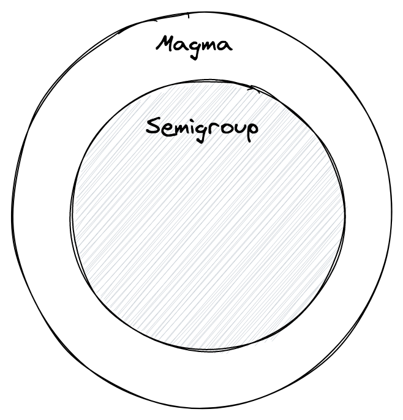
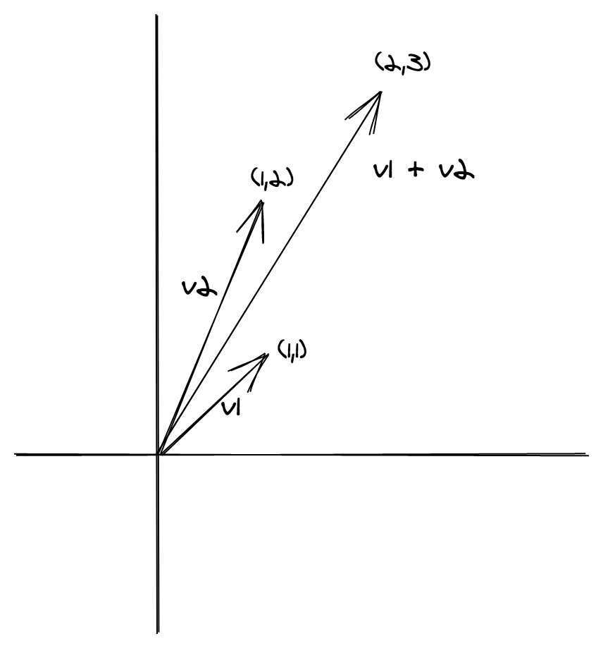

# Modelovanje kompozicije pomoću polugrupa

> [!NOTE]
> Poglavlje 3 originalnog prevoda. Tekst je neizmenjen — prilagođene su samo putanje do slika i koda i interne veze između poglavlja. [Sadržaj originalnog prevoda](index.md)
>
> Prerada ovog poglavlja planirana je u Celini 3 — Algebra i matematički zakoni (vidi [mapu sadržaja](../mapa-sadrzaja.md)).


Polugrupa (semigroup) je recept za kombinovanje dve (ili više) vrednosti.

Tehnički, polugrupa je algebra; uopšteno, pod terminom "algebra" podrazumeva se određena kombinacija:

- jednog ili više skupova
- jedne ili više operacija nad tim skupovima
- nula ili više zakona kojima te operacije moraju da se povinuju

Algebre su način na koji matematičari obuhvataju neki pojam na najdirektniji mogući način, uklanjajući sve što je suvišno.

> Kada se radi sa algebrom, dozvoljene su samo operacije koje definiše sama algebra i to u skladu sa njenim zakonima

Ekvivalent algebri u programiranju su **interfejsi**:

> Kada se radi sa interfejsom, dozvoljene su samo operacije koje definiše sam interfejs i to u skladu sa njegovim zakonima.

Pre nego što se pozabavimo polugrupama, pogledajmo prvi jednostavan primer algebre koja im prethodi: magmu.

## Definicija magme

Možemo da koristimo TypeScript `interface` za modelovanje magme:

```ts
interface Magma<A> {
  readonly concat: (first: A, second: A) => A
}
```

Dakle, imamo operaciju `concat` koja uzima dve vrednosti nekog tipa `A` i vraća novu vrednost istog tipa (svojstvo zatvorenosti). Pošto i sam rezultat može da se koristi kao ulaz, operacija može da se ponavlja po želji. Drugim rečima, `concat` je [kombinator](02-dva-stuba-funkcionalnog-programiranja.md#kompozicija) za tip `A`.

**Kviz**. To što je neka operacija zatvorena nije trivijalno svojstvo; možete li da navedete primer operacije nad prirodnim brojevima (odnosno pozitivnim celim brojevima) za koju svojstvo zatvorenosti ne važi?

Da bismo imali konkretnu instancu magme za određeni tip, potrebno je, dakle, definisati objekat koji odgovara ovom interfejsu.

**Primer** (instanca `Magma` za tip `number`)

```ts
import { Magma } from 'fp-ts/Magma'

const MagmaSub: Magma<number> = {
  concat: (first, second) => first - second
}

console.log(
  MagmaSub.concat(
    MagmaSub.concat(MagmaSub.concat(MagmaSub.concat(10, 2), 3), 1),
    2
  )
)
// => 2

// helper
const getPipeableConcat = <A>(M: Magma<A>) => (second: A) => (first: A): A =>
  M.concat(first, second)

const concat = getPipeableConcat(MagmaSub)

// primer upotrebe

import { pipe } from 'fp-ts/function'

pipe(10, concat(2), concat(3), concat(1), concat(2), console.log)
// => 2
```

Primetite da je definicija `concat` osmišljena tako da olakša njegovu upotrebu sa `pipe`.

**Kviz**. Posmatrajmo sledeću funkciju koja pretvara listu u rečnik; zašto se kao parametar zahteva `Magma`?

```ts
import { pipe } from 'fp-ts/function'
import { Magma } from 'fp-ts/Magma'

declare const fromReadonlyArray: <A>(
  M: Magma<A>
) => (as: ReadonlyArray<readonly [string, A]>) => Record<string, A>

// primer upotrebe

const MagmaSub: Magma<number> = {
  concat: (first, second) => first - second
}

pipe(
  [
    ['a', 1],
    ['b', 2]
  ],
  fromReadonlyArray(MagmaSub),
  console.log
) // => { a: 1, b: 2 }
pipe(
  [
    ['a', 1],
    ['b', 2],
    ['a', 3]
  ],
  fromReadonlyArray(MagmaSub),
  console.log
) // => { a: -2, b: 2 }
```

`Magma<A>` je veoma jednostavna algebra:

- skup (`A`)
- operacija (`concat`)
- nijedan zakon

pogledajmo sada algebru koja definiše jedan zakon: polugrupe.

## Definicija polugrupe

Ako je operacija `concat` neke `Magma` uz to i **asocijativna**, onda govorimo o polugrupi.

Za binarnu operaciju `*` kaže se da je "asocijativna" ako važi:

```ts
(x * y) * z = x * (y * z)
```

za svako `x`, `y`, `z`.

Asocijativnost nam govori da ne moramo da brinemo o zagradama u izrazima i da, ako želimo, možemo jednostavno da napišemo `x * y * z` (nema dvosmislenosti).

**Primer**

Spajanje (konkatenacija) stringova (`+`) ima svojstvo asocijativnosti.

```ts
("a" + "b") + "c" = "a" + ("b" + "c") = "abc"
```

Svaka polugrupa je magma, ali nije svaka magma polugrupa.

<center>

</center>

**Primer**

Magma `MagmaSub` koju smo videli u prethodnom odeljku nije polugrupa jer njena operacija `concat` nije asocijativna:

```ts
import { pipe } from 'fp-ts/function'
import { Magma } from 'fp-ts/Magma'

const MagmaSub: Magma<number> = {
  concat: (first, second) => first - second
}

pipe(MagmaSub.concat(MagmaSub.concat(1, 2), 3), console.log) // => -4
pipe(MagmaSub.concat(1, MagmaSub.concat(2, 3)), console.log) // => 2
```

Polugrupe obuhvataju suštinu operacija koje mogu da se paralelizuju.

Zaista, ako znamo da neka operacija `*` ima svojstvo asocijativnosti, možemo da podelimo izračunavanje na dva podizračunavanja, od kojih svako može dalje da se deli

```ts
a * b * c * d * e * f * g * h = ((a * b) * (c * d)) * ((e * f) * (g * h))
```

Podizračunavanja mogu da se raspodele i izvrše paralelno, a zatim se prikupe njihovi delimični rezultati i od njih sastavi konačan rezultat.

Kao što je već bio slučaj sa `Magma`, polugrupe mogu da se modeluju pomoću TypeScript `interface`:

```ts
interface Semigroup<A> {
  readonly concat: (first: A, second: A) => A
}
```

Kao što vidite, definicija je identična onoj za `Magma`, ali postoji važna razlika: mora da važi sledeći zakon (koji, nažalost, ne može da se kodira u sistemu tipova TypeScript-a):

**Associativity**. Ako je `S` polugrupa, mora da važi:

```ts
S.concat(S.concat(x, y), z) = S.concat(x, S.concat(y, z))
```

za svako `x`, `y`, `z` iz `A`

**Primer**

Implementirajmo polugrupu za `ReadonlyArray<string>`

```ts
import * as Se from 'fp-ts/Semigroup'

const Semigroup: Se.Semigroup<ReadonlyArray<string>> = {
  concat: (first, second) => first.concat(second)
}
```

Kao što vidite, naziv `concat` ima naročito smisla za `ReadonlyArray`, ali, u zavisnosti od konteksta i tipa `A` za koji implementiramo instancu, operacija polugrupe `concat` može da se tumači na različite načine:

- "nadovezivati"
- "kombinovati"
- "merging"
- "stapati"
- "birati"
- "sabirati"
- "zamenjivati"

i još mnogo toga.

**Primer**

Evo kako se implementira polugrupa `(number, +)` gde je `+` uobičajeno sabiranje brojeva:

```ts
import { Semigroup } from 'fp-ts/Semigroup'

/** number `Semigroup` under addition */
const SemigroupSum: Semigroup<number> = {
  concat: (first, second) => first + second
}
```

**Kviz**. Da li kombinator `concat` definisan u demou [`01_retry.ts`](../../src/01_retry.ts) može da se iskoristi za definisanje instance `Semigroup` za tip `RetryPolicy`?

Primetite da se, kada je tip fiksiran, može definisati **više instanci** interfejsa `Semigroup`.

Na primer, ako ponovo posmatramo tip `number`, možemo da definišemo polugrupu `(number, *)` gde je `*` uobičajeno množenje brojeva:

```ts
import { Semigroup } from 'fp-ts/Semigroup'

/** number `Semigroup` under multiplication */
const SemigroupProduct: Semigroup<number> = {
  concat: (first, second) => first * second
}
```

Još jedan primer, ovog puta sa stringovima:

```ts
import { Semigroup } from 'fp-ts/Semigroup'

const SemigroupString: Semigroup<string> = {
  concat: (first, second) => first + second
}
```

I još dva primera, sa `boolean`:

```ts
import { Semigroup } from 'fp-ts/Semigroup'

const SemigroupAll: Semigroup<boolean> = {
  concat: (first, second) => first && second
}

const SemigroupAny: Semigroup<boolean> = {
  concat: (first, second) => first || second
}
```

## Funkcija `concatAll`

Po definiciji, `concat` kombinuje samo dva elementa iz `A` odjednom; da li je moguće kombinovati više elemenata?

Funkcija `concatAll` kao ulaz prima instancu polugrupe, početnu vrednost i niz elemenata koje treba kombinovati:

```ts
import * as S from 'fp-ts/Semigroup'
import * as N from 'fp-ts/number'

const sum = S.concatAll(N.SemigroupSum)(2)

console.log(sum([1, 2, 3, 4])) // => 12

const product = S.concatAll(N.SemigroupProduct)(3)

console.log(product([1, 2, 3, 4])) // => 72
```

**Kviz**. Zašto mi je potrebna početna vrednost?

**Primer**

Kao dodatne primere primene `concatAll`, možemo ponovo da implementiramo neke popularne funkcije iz standardne biblioteke JavaScript-a:

```ts
import * as B from 'fp-ts/boolean'
import { concatAll } from 'fp-ts/Semigroup'
import * as S from 'fp-ts/struct'

const every = <A>(predicate: (a: A) => boolean) => (
  as: ReadonlyArray<A>
): boolean => concatAll(B.SemigroupAll)(true)(as.map(predicate))

const some = <A>(predicate: (a: A) => boolean) => (
  as: ReadonlyArray<A>
): boolean => concatAll(B.SemigroupAny)(false)(as.map(predicate))

const assign: (as: ReadonlyArray<object>) => object = concatAll(
  S.getAssignSemigroup<object>()
)({})
```

**Kviz**. Da li je sledeća instanca "legalna" (odnosno, da li poštuje zakone polugrupa)?

```ts
import { Semigroup } from 'fp-ts/Semigroup'

/** Always return the first argument */
const first = <A>(): Semigroup<A> => ({
  concat: (first, _second) => first
})
```

**Kviz**. Da li je sledeća instanca legalna?

```ts
import { Semigroup } from 'fp-ts/Semigroup'

/** Always return the second argument */
const last = <A>(): Semigroup<A> => ({
  concat: (_first, second) => second
})
```

## Dualna polugrupa

Kada je data instanca polugrupe, moguće je dobiti drugu instancu jednostavnom zamenom redosleda u kom se elementi kombinuju:

```ts
import { pipe } from 'fp-ts/function'
import { Semigroup } from 'fp-ts/Semigroup'
import * as S from 'fp-ts/string'

// ovo je kombinator polugrupa...
const reverse = <A>(S: Semigroup<A>): Semigroup<A> => ({
  concat: (first, second) => S.concat(second, first)
})

pipe(S.Semigroup.concat('a', 'b'), console.log) // => 'ab'
pipe(reverse(S.Semigroup).concat('a', 'b'), console.log) // => 'ba'
```

**Kviz**. Ovaj kombinator ima smisla zato što operacija `concat` u opštem slučaju nije **komutativna**, odnosno ne važi nužno uvek `concat(x, y) = concat(y, x)`; možete li da navedete primer u kom `concat` nije komutativna? A primer u kom jeste?

## Polugrupa proizvoda

Pokušajmo da definišemo instance polugrupe za složenije tipove:

```ts
import * as N from 'fp-ts/number'
import { Semigroup } from 'fp-ts/Semigroup'

// modeluje vektor koji polazi iz koordinatnog početka
type Vector = {
  readonly x: number
  readonly y: number
}

// modeluje zbir dva vektora
const SemigroupVector: Semigroup<Vector> = {
  concat: (first, second) => ({
    x: N.SemigroupSum.concat(first.x, second.x),
    y: N.SemigroupSum.concat(first.y, second.y)
  })
}
```

**Primer**

```ts
const v1: Vector = { x: 1, y: 1 }
const v2: Vector = { x: 1, y: 2 }

console.log(SemigroupVector.concat(v1, v2)) // => { x: 2, y: 3 }
```

<center>

</center>

Previše boilerplate-a? Dobra vest je da nam **matematička teorija** koja stoji iza pojma polugrupe kaže da možemo da konstruišemo instancu polugrupe za struct kao što je `Vector` ako smo u stanju da obezbedimo instancu polugrupe za svako njegovo polje.

Zgodno je to što modul `fp-ts/Semigroup` izvozi kombinator `struct`:

```ts
import { struct } from 'fp-ts/Semigroup'

// modeluje zbir dva vektora
const SemigroupVector: Semigroup<Vector> = struct({
  x: N.SemigroupSum,
  y: N.SemigroupSum
})
```

**Napomena**. Postoji kombinator sličan kombinatoru `struct`, ali koji radi sa torkama: `tuple`

```ts
import * as N from 'fp-ts/number'
import { Semigroup, tuple } from 'fp-ts/Semigroup'

// modeluje vektor koji polazi iz koordinatnog početka
type Vector = readonly [number, number]

// modeluje zbir dva vektora
const SemigroupVector: Semigroup<Vector> = tuple(N.SemigroupSum, N.SemigroupSum)

const v1: Vector = [1, 1]
const v2: Vector = [1, 2]

console.log(SemigroupVector.concat(v1, v2)) // => [2, 3]
```

**Kviz**. Da li je tačno da, ako imam polugrupu za `A` i izaberem bilo koji element `middle` iz `A`, pa ga umetnem između dva parametra funkcije `concat`, ponovo dobijam polugrupu?

```ts
import { pipe } from 'fp-ts/function'
import { Semigroup } from 'fp-ts/Semigroup'
import * as S from 'fp-ts/string'

export const intercalate = <A>(middle: A) => (
  S: Semigroup<A>
): Semigroup<A> => ({
  concat: (first, second) => S.concat(S.concat(first, middle), second)
})

const SemigroupIntercalate = pipe(S.Semigroup, intercalate('|'))

pipe(
  SemigroupIntercalate.concat('a', SemigroupIntercalate.concat('b', 'c')),
  console.log
) // => 'a|b|c'
```

## Ne mogu da pronađem instancu!

Asocijativnost je veoma jako svojstvo; šta se dešava ako, za neki određeni tip `A`, ne uspemo da pronađemo asocijativnu operaciju nad `A`?

Pretpostavimo da imamo tip `User` definisan ovako:

```ts
type User = {
  readonly id: number
  readonly name: string
}
```

i da se u mojoj bazi podataka nalazi mnogo kopija istog `User` (na primer, to bi mogla da bude istorija njegovih izmena)

```ts
// interni API-ji
declare const getCurrent: (id: number) => User
declare const getHistory: (id: number) => ReadonlyArray<User>
```

i da treba da osmislim javni API

```ts
export declare const getUser: (id: number) => User
```

koji uzima u obzir sve kopije na osnovu nekog kriterijuma; na primer, kriterijum bi mogao da bude da se vrati najnovija kopija, ili najstarija, ili uvek trenutna kopija, itd...

Naravno, možemo da definišemo posebne API-je za svaki kriterijum, dakle:

```ts
export declare const getMostRecentUser: (id: number) => User
export declare const getLeastRecentUser: (id: number) => User
export declare const getCurrentUser: (id: number) => User
// itd...
```

Ovde ću, međutim, o ovom problemu dizajna govoriti sa što opštije tačke gledišta.

Dakle, da bi se vratila vrednost tipa `User`, moram da uzmem u obzir sve kopije i da napravim njihov "merge" (ili "izbor").

Drugim rečima, kriterijum možemo da modelujemo polugrupom!

Međutim, nije očigledno šta znači "napraviti merge dva korisnika", niti kako ta operacija merge-a može da bude asocijativna.

**Uvek** možete da definišete instancu polugrupe za **bilo koji** tip tako što ćete konstruisati instancu polugrupe ne za `A`, već za `ReadonlyNonEmptyArray<A>` (neprazan niz elemenata tipa `A`), koja se naziva **slobodna polugrupa** nad `A`.

```ts
import { Semigroup } from 'fp-ts/Semigroup'

// modeluje neprazan niz, odnosno niz sa bar jednim elementom
type ReadonlyNonEmptyArray<A> = ReadonlyArray<A> & {
  readonly 0: A
}

// nadovezivanje dva neprazna niza je ponovo neprazan niz
const getSemigroup = <A>(): Semigroup<ReadonlyNonEmptyArray<A>> => ({
  concat: (first, second) => [first[0], ...first.slice(1), ...second]
})
```

a zatim preslikati elemente iz `A` u "singltone" tipa `ReadonlyNonEmptyArray<A>`, odnosno u nizove sa samo jednim elementom:

```ts
// ubacuje vrednost u neprazan niz
const of = <A>(a: A): ReadonlyNonEmptyArray<A> => [a]
```

Primenimo ovu tehniku na tip `User`:

```ts
import {
  getSemigroup,
  of,
  ReadonlyNonEmptyArray
} from 'fp-ts/ReadonlyNonEmptyArray'
import { Semigroup } from 'fp-ts/Semigroup'

type User = {
  readonly id: number
  readonly name: string
}

// ovo je polugrupa ne za `User`, već za `ReadonlyNonEmptyArray<User>`
const S: Semigroup<ReadonlyNonEmptyArray<User>> = getSemigroup<User>()

declare const user1: User
declare const user2: User
declare const user3: User

// const merge: ReadonlyNonEmptyArray<User>
const merge = S.concat(S.concat(of(user1), of(user2)), of(user3))

// isti rezultat dobijam "ručnim pakovanjem" korisnika
const merge2: ReadonlyNonEmptyArray<User> = [user1, user2, user3]
```

Slobodna polugrupa nad `A`, dakle, nije ništa drugo nego polugrupa čiji su elementi svi mogući konačni i neprazni nizovi elemenata iz `A`.

Slobodna polugrupa nad `A` može da se posmatra kao _lenj_ (lazy) način nadovezivanja elemenata iz `A`, kojim se čuva celokupan informacioni sadržaj.

Zaista, vrednost `merge`, koja sadrži `[user1, user2, user3]`, i dalje mi govori koje elemente treba nadovezati i kojim redosledom.

Sada imam tri moguće opcije prilikom dizajniranja API-ja `getUser`:

1. u stanju sam da definišem `Semigroup<User>` i želim odmah da izvršim merging

```ts
declare const SemigroupUser: Semigroup<User>

export const getUser = (id: number): User => {
  const current = getCurrent(id)
  const history = getHistory(id)
  // odmah vršim merging
  return concatAll(SemigroupUser)(current)(history)
}
```

2. nisam u stanju da definišem `Semigroup<User>` ili želim da strategiju merging-a ostavim podesivom, pa je tražim od onoga ko koristi moj API (consumer)

```ts
export const getUser = (SemigroupUser: Semigroup<User>) => (
  id: number
): User => {
  const current = getCurrent(id)
  const history = getHistory(id)
  // odmah vršim merging
  return concatAll(SemigroupUser)(current)(history)
}
```

3. nisam u stanju da definišem `Semigroup<User>` i ne želim da ga tražim od onoga ko koristi moj API

Ovo je slučaj u kom nam slobodna polugrupa nad `User` može pomoći.

```ts
export const getUser = (id: number): ReadonlyNonEmptyArray<User> => {
  const current = getCurrent(id)
  const history = getHistory(id)
  // odlučujem da NE izvršim merging i vraćam slobodnu polugrupu nad `User`
  return [current, ...history]
}
```

Osim toga, čak i ako imam na raspolaganju instancu polugrupe za `A`, ipak mogu da odlučim da koristim slobodnu polugrupu iz sledećih razloga:

- izbegava se izvršavanje možda nepotrebnih izračunavanja (pretpostavite da je merging skup)
- izbegava se prosleđivanje instance polugrupe unaokolo
- i dalje se omogućava onome ko koristi moje API-je da odredi strategiju merging-a (pomoću `concatAll`)

## Polugrupe izvedene iz uređenja

Pošto je `number` **totalno uređen** (odnosno, za bilo koja dva broja `x` i `y` važi jedan od sledećih uslova: `x <= y` ili `y <= x`), možemo da definišemo još dve njegove instance polugrupe koristeći `min` i `max` kao operacije:

```ts
import { Semigroup } from 'fp-ts/Semigroup'

const SemigroupMin: Semigroup<number> = {
  concat: (first, second) => Math.min(first, second)
}

const SemigroupMax: Semigroup<number> = {
  concat: (first, second) => Math.max(first, second)
}
```

**Kviz**. Zašto je važno da `number` bude _totalno_ uređen?

Bilo bi korisno da ove dve polugrupe (`SemigroupMin` i `SemigroupMax`) možemo da definišemo i za druge tipove osim `number`.

Da li je moguće obuhvatiti pojam totalne uređenosti i za druge tipove? Da bismo to uradili, najpre moramo da obuhvatimo pojam _jednakosti_.

---

[← Prethodno poglavlje](02-dva-stuba-funkcionalnog-programiranja.md) · [Sadržaj](index.md) · [Sledeće poglavlje →](04-jednakost-eq.md)
