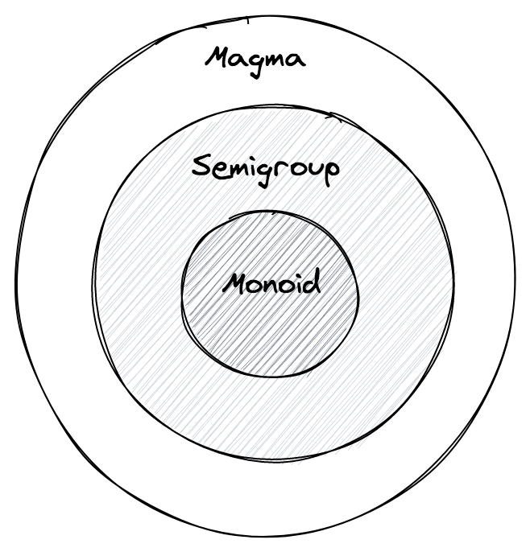

# Modelovanje kompozicije pomoću monoida

> [!NOTE]
> Poglavlje 6 originalnog prevoda. Tekst je neizmenjen — prilagođene su samo putanje do slika i koda i interne veze između poglavlja. [Sadržaj originalnog prevoda](index.md)
>
> Prerada ovog poglavlja planirana je u Celini 3 — Algebra i matematički zakoni (vidi [mapu sadržaja](../mapa-sadrzaja.md)).


Ako definiciji polugrupe dodamo još jedan uslov, naime da postoji element `empty` u `A`
takav da za svaki element `a` iz `A` važi

- **Right identity**: `concat(a, empty) = a`
- **Left identity**: `concat(empty, a) = a`

onda govorimo o monoidu, a element `empty` nazivamo **neutralni element** (ili "jedinica").

Kao i kod `Magma` i `Semigroup`, monoidi se mogu modelovati pomoću TypeScript interfejsa (`interface`):

```ts
import { Semigroup } from 'fp-ts/Semigroup'

interface Monoid<A> extends Semigroup<A> {
  readonly empty: A
}
```

Mnoge polugrupe koje smo videli u prethodnim odeljcima mogu se obogatiti tako da postanu instance `Monoid`:

```ts
import { Monoid } from 'fp-ts/Monoid'

/** number `Monoid` under addition */
const MonoidSum: Monoid<number> = {
  concat: (first, second) => first + second,
  empty: 0
}

/** number `Monoid` under multiplication */
const MonoidProduct: Monoid<number> = {
  concat: (first, second) => first * second,
  empty: 1
}

const MonoidString: Monoid<string> = {
  concat: (first, second) => first + second,
  empty: ''
}

/** boolean monoid under conjunction */
const MonoidAll: Monoid<boolean> = {
  concat: (first, second) => first && second,
  empty: true
}

/** boolean monoid under disjunction */
const MonoidAny: Monoid<boolean> = {
  concat: (first, second) => first || second,
  empty: false
}
```

**Kviz**. U odeljku o polugrupama videli smo da `ReadonlyArray<string>` ima instancu `Semigroup`:

```ts
import { Semigroup } from 'fp-ts/Semigroup'

const Semigroup: Semigroup<ReadonlyArray<string>> = {
  concat: (first, second) => first.concat(second)
}
```

da li postoji i neutralni element? Da li je moguće uopštiti rezultat na `ReadonlyArray<A>` za bilo koji tip `A`?

**Kviz** (teško). Dokažite da je, za dati monoid, neutralni element jedinstven.

Praktična posledica je sledeća: ako ste pronašli neutralni element, prestanite da tražite!

Svaki monoid je polugrupa, ali nije svaka polugrupa monoid.

<center>

</center>

**Primer**

Razmotrite sledeći primer:

```ts
import { pipe } from 'fp-ts/function'
import { intercalate } from 'fp-ts/Semigroup'
import * as S from 'fp-ts/string'

const SemigroupIntercalate = pipe(S.Semigroup, intercalate('|'))

console.log(S.Semigroup.concat('a', 'b')) // => 'ab'
console.log(SemigroupIntercalate.concat('a', 'b')) // => 'a|b'
console.log(SemigroupIntercalate.concat('a', '')) // => 'a|'
```

Primetite da nije moguće pronaći vrednost `empty` tipa `string` takvu da je `concat(a, empty) = a`.

Na kraju, jedan "egzotičniji" primer, sa funkcijama:

**Primer**

**Endomorfizam** je funkcija kod koje se ulazni i izlazni tip poklapaju:

```ts
type Endomorphism<A> = (a: A) => A
```

Za dati tip `A`, endomorfizmi na `A` čine monoid, takav da:

- operacija `concat` je uobičajena kompozicija funkcija
- neutralni element je funkcija identiteta

```ts
import { Endomorphism, flow, identity } from 'fp-ts/function'
import { Monoid } from 'fp-ts/Monoid'

export const getEndomorphismMonoid = <A>(): Monoid<Endomorphism<A>> => ({
  concat: flow,
  empty: identity
})
```

## Funkcija `concatAll`

Kada koristimo monoid umesto polugrupe, konkatenacija više elemenata je još jednostavnija: nije potrebno eksplicitno navesti početnu vrednost.

**Kviz**. Zašto nije potrebno navesti početnu vrednost?

```ts
import { concatAll } from 'fp-ts/Monoid'
import * as S from 'fp-ts/string'
import * as N from 'fp-ts/number'
import * as B from 'fp-ts/boolean'

console.log(concatAll(N.MonoidSum)([1, 2, 3, 4])) // => 10
console.log(concatAll(N.MonoidProduct)([1, 2, 3, 4])) // => 24
console.log(concatAll(S.Monoid)(['a', 'b', 'c'])) // => 'abc'
console.log(concatAll(B.MonoidAll)([true, false, true])) // => false
console.log(concatAll(B.MonoidAny)([true, false, true])) // => true
```

## Monoid proizvoda

Kao što smo već videli kod polugrupa, moguće je konstruisati instancu monoida za struct ako možemo da obezbedimo instancu monoida za svako njegovo polje.

**Primer**

```ts
import { Monoid, struct } from 'fp-ts/Monoid'
import * as N from 'fp-ts/number'

type Point = {
  readonly x: number
  readonly y: number
}

const Monoid: Monoid<Point> = struct({
  x: N.MonoidSum,
  y: N.MonoidSum
})
```

**Napomena**. Postoji kombinator sličan kombinatoru `struct` koji radi sa torkama: `tuple`.

```ts
import { Monoid, tuple } from 'fp-ts/Monoid'
import * as N from 'fp-ts/number'

type Point = readonly [number, number]

const Monoid: Monoid<Point> = tuple(N.MonoidSum, N.MonoidSum)
```

**Kviz**. Da li je moguće definisati "slobodni monoid" proizvoljnog tipa `A`?

**Demo** (implementacija sistema za crtanje geometrijskih oblika na canvas-u)

[`03_shapes.ts`](../../src/03_shapes.ts)

---

[← Prethodno poglavlje](05-uredjenje-ord.md) · [Sadržaj](index.md) · [Sledeće poglavlje →](07-ciste-i-parcijalne-funkcije.md)
