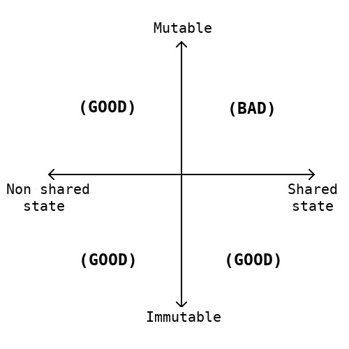

# Čiste funkcije i parcijalne funkcije

> [!NOTE]
> Poglavlje 7 originalnog prevoda. Tekst je neizmenjen — prilagođene su samo putanje do slika i koda i interne veze između poglavlja. [Sadržaj originalnog prevoda](index.md)
>
> Ovo poglavlje je prerađeno u novoj strukturi kursa: [Čiste funkcije](../01-osnove/02-ciste-funkcije.md), [Sporedni efekti](../01-osnove/03-sporedni-efekti.md), [Kompozicija funkcija](../01-osnove/06-kompozicija-funkcija.md), [Totalne i parcijalne funkcije](../01-osnove/08-totalne-i-parcijalne-funkcije.md).


U prvom poglavlju kursa videli smo neformalnu definiciju čiste funkcije:

> Čista funkcija je procedura koja za isti ulaz uvek vraća isti izlaz i nema nikakav uočljiv sporedni efekat.

Ovakva formulacija može da ostavi prostora za nedoumice (na primer, šta je to "sporedni efekat"?)

Pogledajmo zato formalnu definiciju:

Podsetimo se da, ako su `X` i `Y` dva skupa, onda se sa `X × Y` označava njihov _Dekartov proizvod_, odnosno skup

```
X × Y = { (x, y) | x ∈ X, y ∈ Y }
```

**Definicija**. _Funkcija_ `f: X ⟶ Y` je podskup `f` skupa `X × Y` takav da
za svako `x ∈ X` postoji tačno jedno `y ∈ Y` takvo da par `(x, y) ∈ f`.

Skup `X` naziva se _domen_ funkcije `f`, a `Y` njen _kodomen_.

Primetite da skup `f` mora da bude opisan _statički_ u trenutku definisanja funkcije
(odnosno elementi tog skupa ne mogu da se menjaju tokom vremena niti pod uticajem bilo kakvog unutrašnjeg ili spoljašnjeg uslova).

**Primer**

Funkcija `double: Nat ⟶ Nat`, gde je `Nat` skup prirodnih brojeva, jeste podskup Dekartovog proizvoda `Nat × Nat` koji čine parovi `{ (1, 2), (2, 4), (3, 6), ...}`.

U TypeScript-u bi `f` mogla da se definiše ovako:

```ts
const f: Record<number, number> = {
  1: 2,
  2: 4,
  3: 6
  ...
}
```

Definicija iz primera naziva se _ekstenzionalna_ definicija funkcije, odnosno elementi domena se nabrajaju jedan po jedan i za svaki od njih se navodi odgovarajući element kodomena.
Naravno, kada je skup beskonačan, kao u ovom slučaju, ovakva definicija može da bude pomalo "nezgodna".

Ovaj problem može da se zaobiđe uvođenjem takozvane _intenzionalne_ definicije,
odnosno izražava se uslov koji mora da važi za sve parove `(x, y)` koji pripadaju skupu `f`, a to je `y = x * 2`. To je poznati oblik u kome pišemo funkciju `double` i način na koji je definišemo u TypeScript-u:

```ts
const double = (x: number): number => x * 2
```

Definicija funkcije kao podskupa Dekartovog proizvoda pokazuje da su u matematici sve funkcije čiste:
nema akcije, promene stanja niti izmene elemenata (koji se smatraju nepromenljivim) skupova o kojima je reč.
U funkcionalnom programiranju implementacija funkcija treba da teži ovom idealnom modelu.

**Kviz**. Koje od sledećih procedura su čiste funkcije?

```ts
const coefficient1 = 2
export const f1 = (n: number) => n * coefficient1

// ------------------------------------------------------

let coefficient2 = 2
export const f2 = (n: number) => n * coefficient2++

// ------------------------------------------------------

let coefficient3 = 2
export const f3 = (n: number) => n * coefficient3

// ------------------------------------------------------

export const f4 = (n: number) => {
  const out = n * 2
  console.log(out)
  return out
}

// ------------------------------------------------------

interface User {
  readonly id: number
  readonly name: string
}

export declare const f5: (id: number) => Promise<User>

// ------------------------------------------------------

import * as fs from 'fs'

export const f6 = (path: string): string =>
  fs.readFileSync(path, { encoding: 'utf8' })

// ------------------------------------------------------

export const f7 = (
  path: string,
  callback: (err: Error | null, data: string) => void
): void => fs.readFile(path, { encoding: 'utf8' }, callback)
```

To što je funkcija čista ne znači nužno da je mutabilnost zabranjena: lokalno je dozvoljena
ako ne izlazi van granica implementacije.



**Primer** (Implementacija funkcije `concatAll` za monoide)

```ts
import { Monoid } from 'fp-ts/Monoid'

const concatAll = <A>(M: Monoid<A>) => (as: ReadonlyArray<A>): A => {
  let out: A = M.empty // <= lokalna mutabilnost
  for (const a of as) {
    out = M.concat(out, a)
  }
  return out
}
```

Pravi cilj je uvek da se obezbedi osnovno svojstvo **referencijalne transparentnosti**.

Ugovor koji sklapamo sa korisnikom našeg API-ja definisan je njegovim potpisom:

```ts
declare const concatAll: <A>(M: Monoid<A>) => (as: ReadonlyArray<A>) => A
```

i obećanjem da ćemo poštovati referencijalnu transparentnost; tehnički detalji o tome kako je funkcija konkretno implementirana nisu bitni i nisu predmet razmatranja, tako da postoji potpuna sloboda.

Dakle, kako se definiše "sporedni efekat"? Jednostavno, kao negacija referencijalne transparentnosti:

> Izraz sadrži "sporedni efekat" ako nije referencijalno transparentan.

Funkcije se ne oslanjaju samo na prvi od dva stuba funkcionalnog programiranja, već su i primer
drugog stuba: **kompozicije**.

Funkcije se, naime, komponuju:

**Definicija**. Neka su `f: Y ⟶ Z` i `g: X ⟶ Y` dve funkcije; tada se funkcija `h: X ⟶ Z` definisana sa

```
h(x) = f(g(x))
```

naziva _kompozicija_ funkcija `f` i `g` i piše se `h = f ∘ g`

Primetite: da bi dve funkcije `f` i `g` mogle da se komponuju, domen funkcije `f` mora da se poklapa sa kodomenom funkcije `g`.

**Definicija**. _Parcijalna_ funkcija je funkcija koja nije definisana za sve vrednosti domena.

Obrnuto, funkcija koja je definisana za sve vrednosti domena naziva se _totalna_.

**Primer**

```ts
// Get the first element of a `ReadonlyArray`
declare const head: <A>(as: ReadonlyArray<A>) => A
```

**Kviz**. Zašto je funkcija `head` parcijalna?

**Kviz**. Da li je funkcija `JSON.parse` totalna?

```ts
parse: (text: string, reviver?: (this: any, key: string, value: any) => any) =>
  any
```

**Kviz**. Da li je funkcija `JSON.stringify` totalna?

```ts
stringify: (
  value: any,
  replacer?: (this: any, key: string, value: any) => any,
  space?: string | number
) => string
```

U funkcionalnom programiranju teži se tome da se definišu samo **čiste i totalne funkcije** (od sada ću termin "funkcija" koristiti kao sinonim za "čista i totalna funkcija"), pa kako onda postupiti kada imamo posla sa parcijalnom funkcijom?

Srećom, parcijalna funkcija `f: X ⟶ Y` uvek može da se svede na totalnu funkciju tako što se kodomenu doda posebna vrednost koja **ne pripada** skupu `Y`, nazovimo je `None`, i pridruži se svakoj vrednosti iz `X` za koju `f` nije definisana

```
f': X ⟶ Y ∪ None
```

Uvedimo oznaku `Option(Y) = Y ∪ None`.

```
f': X ⟶ Option(Y)
```

Da li je moguće definisati `Option(Y)` u TypeScript-u? U naredna dva poglavlja videćemo kako to može da se uradi.

---

[← Prethodno poglavlje](06-monoidi.md) · [Sadržaj](index.md) · [Sledeće poglavlje →](08-algebarski-tipovi-podataka.md)
