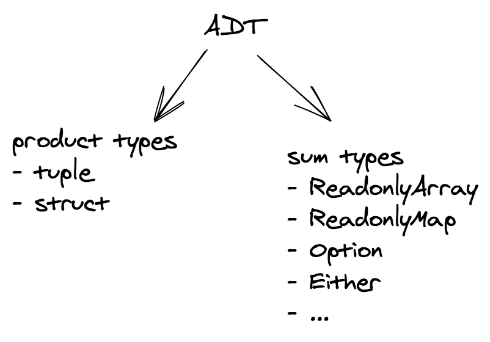

# Algebarski tipovi podataka

> [!NOTE]
> Poglavlje 8 originalnog prevoda. Tekst je neizmenjen — prilagođene su samo putanje do slika i koda i interne veze između poglavlja. [Sadržaj originalnog prevoda](index.md)
>
> Prerada ovog poglavlja planirana je u Celini 2 — Modelovanje podataka i grešaka (vidi [mapu sadržaja](../mapa-sadrzaja.md)).


Dobar prvi korak pri izgradnji nove aplikacije jeste definisanje njenog domenskog modela. TypeScript nudi mnogo alata koji pomažu u tom zadatku. **Algebarski tipovi podataka** (Algebraic Data Types, skraćeno ADT) jedan su od tih alata.

## Šta je algebarski tip podataka?

> In computer programming, especially functional programming and type theory, an algebraic data type is a kind of composite type, i.e., a type formed by combining other types.

Dve česte familije algebarskih tipova podataka su: **tipovi proizvoda** (product types) i **tipovi sume** (sum types).

<center>

</center>

Počnimo od onih poznatijih: tipova proizvoda.

## Tipovi proizvoda

Tip proizvoda je kolekcija tipova T<sub>i</sub> indeksiranih skupom `I`.

Dva česta člana ove familije su `n`-torke, gde je `I` interval prirodnih brojeva:

```ts
type Tuple1 = [string] // I = [0]
type Tuple2 = [string, number] // I = [0, 1]
type Tuple3 = [string, number, boolean] // I = [0, 1, 2]

// Accessing by index
type Fst = Tuple2[0] // string
type Snd = Tuple2[1] // number
```

i struct-ovi, gde je `I` skup labela:

```ts
// I = {"name", "age"}
interface Person {
  name: string
  age: number
}

// Accessing by label
type Name = Person['name'] // string
type Age = Person['age'] // number
```

Tipovi proizvoda mogu biti **polimorfni**.

**Primer**

```ts
//                ↓ type parameter
type HttpResponse<A> = {
  readonly code: number
  readonly body: A
}
```

### Odakle naziv "tipovi proizvoda"?

Ako sa `C(A)` označimo broj stanovnika tipa `A`, što nazivamo **kardinalnost**, onda važi sledeća jednakost:

```ts
C([A, B]) = C(A) * C(B)
```

> kardinalnost proizvoda je proizvod kardinalnosti

**Primer**

Tip `null` ima kardinalnost `1` jer ima samo jednog stanovnika: `null`.

**Primer**

Tip `boolean` ima kardinalnost `2` jer ima dva stanovnika: `true` i `false`.

**Primer**

```ts
type Hour = 1 | 2 | 3 | 4 | 5 | 6 | 7 | 8 | 9 | 10 | 11 | 12
type Period = 'AM' | 'PM'
type Clock = readonly [Hour, Period]
```

Tip `Hour` ima `12` stanovnika.
Tip `Period` ima `2` stanovnika.
Tip `Clock` ima `12 * 2 = 24` stanovnika.

**Kviz**. Koliko stanovnika ima sledeći tip `Clock`?

```ts
// same as before
type Hour = 1 | 2 | 3 | 4 | 5 | 6 | 7 | 8 | 9 | 10 | 11 | 12
// same as before
type Period = 'AM' | 'PM'

type Clock = {
  readonly hour: Hour
  readonly period: Period
}
```

### Kada mogu da koristim tip proizvoda?

Kad god su njegove komponente **nezavisne**.

```ts
type Clock = readonly [Hour, Period]
```

Ovde su `Hour` i `Period` nezavisni, odnosno vrednost `Hour` ne utiče na vrednost `Period` i obrnuto; svi parovi su legalni i imaju smisla.

## Tipovi sume

Tip sume je struktura podataka koja sadrži vrednost koja može biti jednog od nekoliko različitih (ali fiksnih) tipova. U datom trenutku samo jedan od tipova može biti u upotrebi, a polje koje služi kao "tag" pokazuje koji je od njih u upotrebi.

U zvaničnoj dokumentaciji TypeScript-a nazivaju se [discriminated union](https://www.typescriptlang.org/docs/handbook/unions-and-intersections.html).

Važno je naglasiti da članovi unije koja čini tip sume moraju biti **disjunktni**, odnosno ne smeju da postoje vrednosti koje pripadaju više nego jednom članu.

**Primer**

Tip

```ts
type StringsOrNumbers = ReadonlyArray<string> | ReadonlyArray<number>
```

nije disjunktna unija jer vrednost `[]` (prazan niz) pripada i jednom i drugom članu unije.

**Kviz**. Da li je sledeća unija disjunktna?

```ts
type Member1 = { readonly a: string }
type Member2 = { readonly b: number }
type MyUnion = Member1 | Member2
```

U funkcionalnom programiranju teži se tome da se uvek koriste disjunktne unije.

Srećom, u TypeScript-u postoji siguran način da se garantuje da je unija disjunktna: dodavanje posebnog polja koje služi kao **tag**.

**Primer** (redux actions)

Tip sume `Action` modeluje deo operacija koje mogu da se izvrše u jednoj [todo aplikaciji](https://todomvc.com/).

```ts
export type Action =
  | {
      readonly type: 'ADD_TODO'
      readonly text: string
    }
  | {
      readonly type: 'UPDATE_TODO'
      readonly id: number
      readonly text: string
      readonly completed: boolean
    }
  | {
      readonly type: 'DELETE_TODO'
      readonly id: number
    }
```

Polje `type`, budući da je obavezno i da ima različit tip za svaki član unije, može da se izabere za tag i obezbeđuje da članovi budu disjunktni.

**Napomena**. Ime polja koje služi kao tag bira programer, ono ne mora nužno da bude "type" (u `fp-ts`, na primer, po konvenciji se koristi ime "\_tag").

Sada kada smo videli nekoliko primera, možemo eksplicitnije da preformulišemo šta je algebarski tip podataka:

> In general, an algebraic data type specifies a sum of one or more alternatives, where each alternative is a product of zero or more fields.

Tipovi sume mogu biti **polimorfni** i **rekurzivni**.

**Primer** (linked lists)

```ts
//               ↓ type parameter
export type List<A> =
  | { readonly _tag: 'Nil' }
  | { readonly _tag: 'Cons'; readonly head: A; readonly tail: List<A> }
//                                                              ↑ recursion
```

**Kviz** (TypeScript). Za sledeće strukture podataka odredite da li su tipovi proizvoda ili tipovi sume

- `ReadonlyArray<A>`
- `Record<string, A>`
- `Record<'k1' | 'k2', A>`
- `ReadonlyMap<string, A>`
- `ReadonlyMap<'k1' | 'k2', A>`

### Konstruktori

Tip sume sa `n` članova zahteva (najmanje) `n` **konstruktora**, po jedan za svaki član.

**Primer** (redux action creators)

```ts
export type Action =
  | {
      readonly type: 'ADD_TODO'
      readonly text: string
    }
  | {
      readonly type: 'UPDATE_TODO'
      readonly id: number
      readonly text: string
      readonly completed: boolean
    }
  | {
      readonly type: 'DELETE_TODO'
      readonly id: number
    }

export const add = (text: string): Action => ({
  type: 'ADD_TODO',
  text
})

export const update = (
  id: number,
  text: string,
  completed: boolean
): Action => ({
  type: 'UPDATE_TODO',
  id,
  text,
  completed
})

export const del = (id: number): Action => ({
  type: 'DELETE_TODO',
  id
})
```

**Primer** (TypeScript, linked lists)

```ts
export type List<A> =
  | { readonly _tag: 'Nil' }
  | { readonly _tag: 'Cons'; readonly head: A; readonly tail: List<A> }

// a nullary constructor can be implemented as a constant
export const nil: List<never> = { _tag: 'Nil' }

export const cons = <A>(head: A, tail: List<A>): List<A> => ({
  _tag: 'Cons',
  head,
  tail
})

// ekvivalentno nizu [1, 2, 3]
const myList = cons(1, cons(2, cons(3, nil)))
```

**Primer** (Haskell, linked lists)

```haskell
data List a = Nil | Cons a (List a)

myList :: List Int
myList = Cons 1 (Cons 2 (Cons 3 Nil))
```

### Pattern matching

JavaScript nema [pattern matching](https://github.com/tc39/proposal-pattern-matching) (pa ga nema ni TypeScript).

**Primer** (Haskell, linked lists)

```haskell
data List a = Nil | Cons a (List a)

-- vraća `True` ako je lista prazna
isEmpty :: List a -> Bool
isEmpty Nil = True
isEmpty (Cons _ _) = False
```

Ipak, pattern matching možemo da simuliramo pomoću funkcije `match`.

**Primer** (TypeScript, linked lists)

```ts
interface Nil {
  readonly _tag: 'Nil'
}

interface Cons<A> {
  readonly _tag: 'Cons'
  readonly head: A
  readonly tail: List<A>
}

export type List<A> = Nil | Cons<A>

export const match = <R, A>(
  onNil: () => R,
  onCons: (head: A, tail: List<A>) => R
) => (fa: List<A>): R => {
  switch (fa._tag) {
    case 'Nil':
      return onNil()
    case 'Cons':
      return onCons(fa.head, fa.tail)
  }
}

// vraća `true` ako je lista prazna
export const isEmpty = match(
  () => true,
  () => false
)

// vraća prvi element liste ili `undefined`
export const head = match(
  () => undefined,
  (head, _tail) => head
)

// računa dužinu liste (rekurzivno)
export const length: <A>(fa: List<A>) => number = match(
  () => 0,
  (_, tail) => 1 + length(tail)
)
```

**Kviz**. Zašto je API `head` suboptimalan?

**Napomena**. TypeScript nudi odličnu mogućnost vezanu za tipove sume: **exhaustive check**. Naime, type checker može da utvrdi da li su svi slučajevi obrađeni u naredbi `switch` definisanoj u telu funkcije `match`.

### Odakle naziv "tipovi sume"?

Važi sledeća jednakost:

```ts
C(A | B) = C(A) + C(B)
```

> kardinalnost sume je suma kardinalnosti

**Primer** (the `Option` type)

```ts
interface None {
  readonly _tag: 'None'
}

interface Some<A> {
  readonly _tag: 'Some'
  readonly value: A
}

type Option<A> = None | Some<A>
```

Iz opšte formule dobijam `C(Option<A>) = C(None) + C(Some<A>) = 1 + C(A)`, iz čega možemo da izvedemo, na primer, kardinalnost tipa `Option<boolean>`, odnosno `1 + 2 = 3` stanovnika:

- `{ _tag: 'None' }`
- `{ _tag: 'Some', value: true }`
- `{ _tag: 'Some', value: false }`

### Kada treba da koristim tip sume?

Kada bi njegove komponente bile **zavisne** ako bi se implementirale pomoću tipa proizvoda.

**Primer** (`React` props)

```ts
import * as React from 'react'

interface Props {
  readonly editable: boolean
  readonly onChange?: (text: string) => void
}

class Textbox extends React.Component<Props> {
  render() {
    if (this.props.editable) {
      // error: Cannot invoke an object which is possibly 'undefined' :(
      this.props.onChange('a')
    }
    return <div />
  }
}
```

Problem je ovde to što je `Props` modelovan kao proizvod, ali `onChange` **zavisi** od `editable`.

Tip sume je bolji izbor:

```ts
import * as React from 'react'

type Props =
  | {
      readonly type: 'READONLY'
    }
  | {
      readonly type: 'EDITABLE'
      readonly onChange: (text: string) => void
    }

class Textbox extends React.Component<Props> {
  render() {
    switch (this.props.type) {
      case 'EDITABLE':
        this.props.onChange('a') // :)
    }
    return <div />
  }
}
```

**Primer** (node callbacks)

```ts
declare function readFile(
  path: string,
  //         ↓ ---------- ↓ CallbackArgs
  callback: (err?: Error, data?: string) => void
): void
```

Rezultat operacije `readFile` modelovan je tipom proizvoda (preciznije, torkom) koji se prosleđuje kao ulaz funkciji `callback`:

```ts
type CallbackArgs = [Error | undefined, string | undefined]
```

međutim, njegove komponente su **zavisne**: dobija se greška **ili** string:

| err         | data        | legalno? |
| ----------- | ----------- | -------- |
| `Error`     | `undefined` | ✓        |
| `undefined` | `string`    | ✓        |
| `Error`     | `string`    | ✘        |
| `undefined` | `undefined` | ✘        |

Ovaj API nije modelovan u skladu sa sledećom maksimom:

> Make impossible state unrepresentable

Tip sume bi bio bolji izbor, ali koji? Pogledajmo kako se greškama rukuje na funkcionalan način.

**Kviz**. U poslednje vreme se umesto API-ja zasnovanih na callback-ovima sve više koriste API-ji koji vraćaju `Promise`

```ts
declare function readFile(path: string): Promise<string>
```

možete li da navedete jednu manu ovog drugog rešenja kada se koristi statički tipiziran jezik kao što je TypeScript?

---

[← Prethodno poglavlje](07-ciste-i-parcijalne-funkcije.md) · [Sadržaj](index.md) · [Sledeće poglavlje →](09-funkcionalno-rukovanje-greskama.md)
