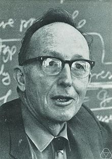
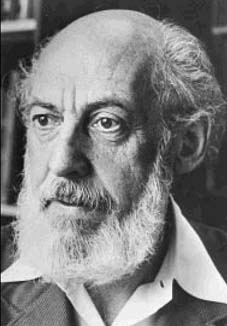
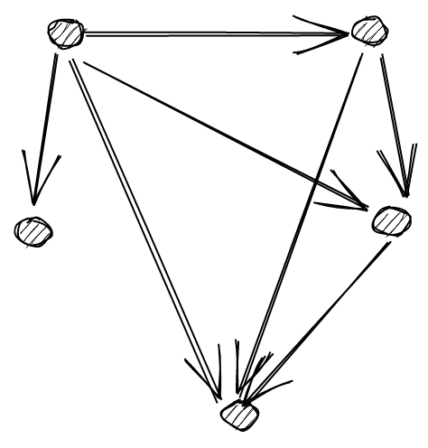
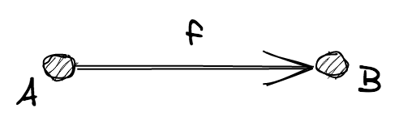
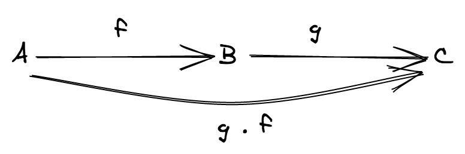
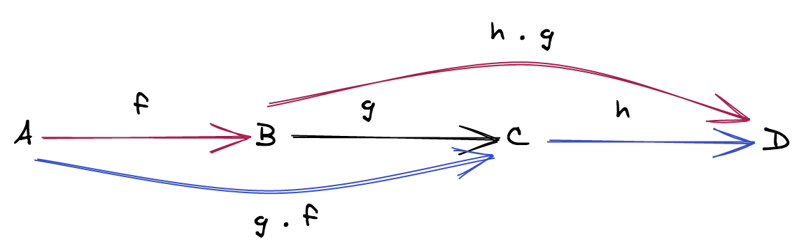
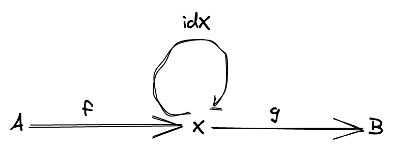
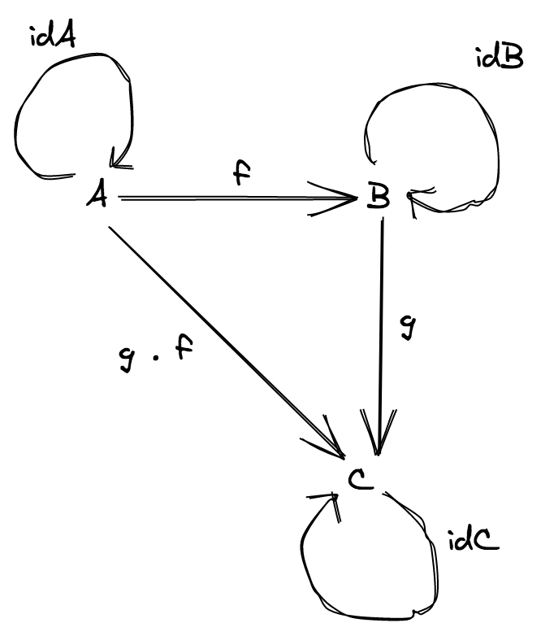
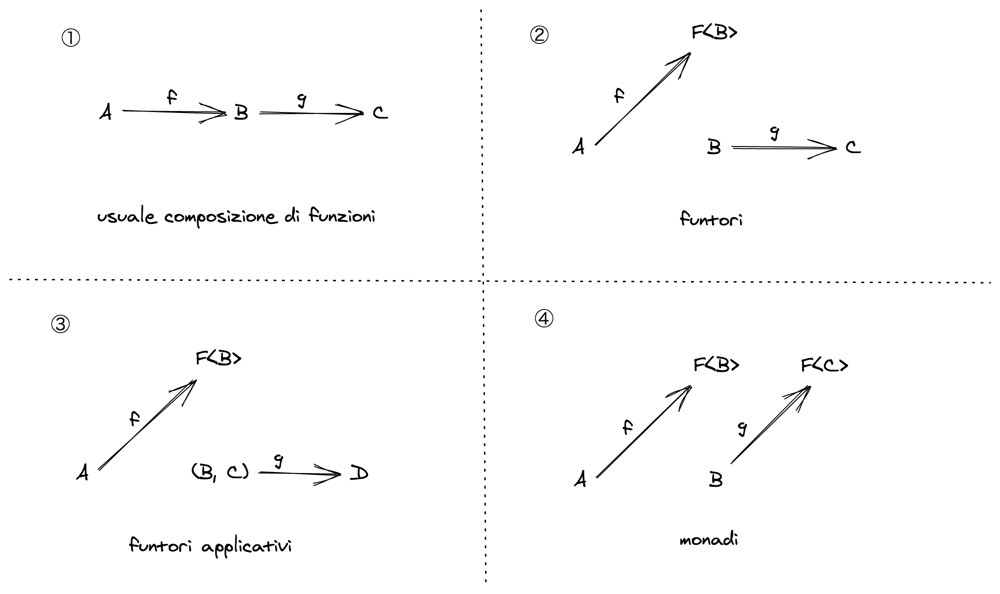

# Teorija kategorija

> [!NOTE]
> Poglavlje 10 originalnog prevoda. Tekst je neizmenjen — prilagođene su samo putanje do slika i koda i interne veze između poglavlja. [Sadržaj originalnog prevoda](index.md)
>
> Prerada ovog poglavlja planirana je u Celini 4 — Apstrakcije i kompozicija (vidi [mapu sadržaja](../mapa-sadrzaja.md)). Pojedini delovi već su korišćeni u lekcijama: [Kompozicija funkcija](../01-osnove/06-kompozicija-funkcija.md), [`pipe` i `flow`](../01-osnove/07-pipe-i-flow.md).


Videli smo da je **kompozicija** kamen temeljac funkcionalnog programiranja.

> And how do we solve problems? We decompose bigger problems into smaller problems. If the smaller problems are still too big,
> we decompose them further, and so on. Finally, we write code that solves all the small problems. And then comes the essence of programming: we compose those pieces of code to create solutions to larger problems. Decomposition wouldn't make sense if we weren't able to put the pieces back together. - Bartosz Milewski

Ali šta to tačno znači? Kada možemo da kažemo da se dve stvari _komponuju_? I kada možemo da kažemo da se dve stvari komponuju _dobro_?

> Entities are composable if we can easily and generally combine their behaviors in some way without having to modify the entities being combined. I think of composability as being the key ingredient necessary for acheiving reuse, and for achieving a combinatorial expansion of what is succinctly expressible in a programming model. - Paul Chiusano

U prvom poglavlju smo naučili da se program u funkcionalnom stilu obično piše kao pipeline:

```ts
const program = pipe(
  input,
  f1, // čista funkcija
  f2, // čista funkcija
  f3, // čista funkcija
  ...
)
```

Ali koliko je lako pridržavati se ovog stila? Da li je to zaista izvodljivo? Hajde da probamo:

```ts
import { pipe } from 'fp-ts/function'
import * as RA from 'fp-ts/ReadonlyArray'

const double = (n: number): number => n * 2

/**
 * Za dati ReadonlyArray<number> program vraća udvostručen prvi element
 */
const program = (input: ReadonlyArray<number>): number =>
  pipe(
    input,
    RA.head, // greška pri kompajliranju! Type 'Option<number>' is not assignable to type 'number'
    double
  )
```

Zašto dobijam grešku pri kompajliranju?

Stvar je u tome što se `head` i `double` ne komponuju!

```ts
head: (as: ReadonlyArray<number>) => Option<number>
double: (n: number) => number
```

kodomen funkcije `head` se ne poklapa sa domenom funkcije `double`.

Šta onda da radimo? Da odustanemo?

Trebalo bi da možemo da se oslonimo na neku **rigoroznu teoriju** koja može da pruži odgovore na tako fundamentalna pitanja.
Potrebna nam je **formalna definicija** pojma kompozicije.

Srećom, već više od 70 godina velika grupa naučnika koji pripadaju najdugovečnijem i najogromnijem open source projektu u istoriji
čovečanstva (matematici) bavi se razvojem teorije posvećene upravo ovoj temi: **teorije kategorija**, koju je osnovao Saunders Mac Lane, zajedno sa Samuelom Eilenbergom (1945).

<center>


(Saunders Mac Lane)



(Samuel Eilenberg)

</center>

U narednim poglavljima videćemo kako kategorija može da predstavlja:

- model nekog opšteg **programskog jezika**
- model pojma **kompozicije**

## Definicija

> Categories capture the essence of composition.

Definicija kategorije, iako nije naročito komplikovana, malo je duga, pa ću je podeliti na dva dela:

- prvi deo je tehnički (pre svega moramo da definišemo njene sastavne delove)
- drugi deo sadrži ono što nas najviše zanima: pojam kompozicije

**Deo I (Sastavni delovi)**

Kategorija je par `(Objects, Morphisms)` gde je:

- `Objects` kolekcija **objekata**
- `Morphisms` kolekcija **morfizama** (koji se nazivaju i "strelice") između objekata



**Napomena**. Termin "objekat" nema nikakve veze sa OOP-om; zamislite objekte kao crne kutije koje ne možete da pregledate, ili kao obične placeholder-e koji služe za definisanje morfizama.

Svaki morfizam `f` ima izvorni objekat `A` i ciljni objekat `B`, pri čemu su i `A` i `B` sadržani u `Objects`. Pišemo `f: A ⟼ B` i kažemo da je "f morfizam iz A u B"



**Napomena**. Radi jednostavnosti, od sada ću na dijagramima koristiti samo oznake za objekte, bez kružića.

**Deo II (Kompozicija)**

Postoji operacija `∘`, koja se naziva "kompozicija", takva da važe sledeća svojstva:

(**composition of morphisms**) kad god su `f: A ⟼ B` i `g: B ⟼ C` dva morfizma u `Morphisms`, mora da postoji i treći morfizam `g ∘ f: A ⟼ C` u `Morphisms`, koji se naziva _kompozicija_ morfizama `f` i `g`



(**associativity**) ako su `f: A ⟼ B`, `g: B ⟼ C` i `h: C ⟼ D`, onda je `h ∘ (g ∘ f) = (h ∘ g) ∘ f`



(**identity**) za svaki objekat `X` postoji morfizam `idX: X ⟼ X`, koji se naziva _morfizam identiteta_ objekta `X`, takav da za svaki morfizam `f: A ⟼ X` i svaki morfizam `g: X ⟼ B` važi `idX ∘ f = f` i `g ∘ idX = g`.



Pogledajmo mali primer

**Primer**



Ova kategorija je veoma jednostavna: ima samo tri objekta i šest morfizama (idA, idB, idC su morfizmi identiteta objekata `A`, `B`, `C`).

## Modelovanje programskih jezika pomoću kategorija

Kategorija se može tumačiti kao pojednostavljeni model **tipiziranog programskog jezika** (typed programming language), gde:

- objekti su **tipovi**
- morfizmi su **funkcije**
- `∘` je uobičajena **kompozicija funkcija**

Dijagram:


stoga se može tumačiti kao zamišljeni (i veoma jednostavan) programski jezik sa samo tri tipa i šest funkcija.

Na primer, mogli bismo da zamislimo:

- `A = string`
- `B = number`
- `C = boolean`
- `f = string => number`
- `g = number => boolean`
- `g ∘ f = string => boolean`

Implementacija bi mogla da izgleda otprilike ovako:

```ts
const idA = (s: string): string => s

const idB = (n: number): number => n

const idC = (b: boolean): boolean => b

const f = (s: string): number => s.length

const g = (n: number): boolean => n > 2

// gf = g ∘ f
const gf = (s: string): boolean => g(f(s))
```

## Kategorija za TypeScript

Možemo da definišemo kategoriju, nazovimo je _TS_, kao pojednostavljeni model jezika TypeScript, gde:

- **objekti** su svi tipovi TypeScript-a: `string`, `number`, `ReadonlyArray<string>`, itd...
- **morfizmi** su sve TypeScript funkcije: `(a: A) => B`, `(b: B) => C`, itd... gde su `A`, `B`, `C`, ... TypeScript tipovi
- **morfizmi identiteta** su svi kodirani jednom polimorfnom funkcijom `const identity = <A>(a: A): A => a`
- **kompozicija morfizama** je uobičajena kompozicija funkcija (koja je asocijativna)

Kao model TypeScript-a, kategorija _TS_ na prvi pogled može da deluje previše ograničeno: nema petlji, nema `if`, nema _skoro_ ničega... pa ipak, ovaj pojednostavljeni model je dovoljno bogat da ispuni naš glavni cilj: da rezonujemo o dobro definisanom pojmu kompozicije.

Sada kada imamo jednostavan model za naš programski jezik, pozabavimo se centralnim problemom kompozicije.

## Centralni problem kompozicije funkcija

U _TS_ možemo da komponujemo dve generičke funkcije `f: (a: A) => B` i `g: (c: C) => D` sve dok je `C = B`.

Ako je ovaj uslov ispunjen, možemo da koristimo funkcije `flow` (ili `pipe`):

```ts
function flow<A, B, C>(f: (a: A) => B, g: (b: B) => C): (a: A) => C {
  return (a) => g(f(a))
}

function pipe<A, B, C>(a: A, f: (a: A) => B, g: (b: B) => C): C {
  return flow(f, g)(a)
}
```

Ali šta se dešava ako je `B != C`? Kako možemo da komponujemo dve funkcije sa takvim osobinama?

U narednim poglavljima videćemo pod kojim uslovima je takva kompozicija moguća.

**Spoiler**

- da bismo komponovali `f: (a: A) => B` sa `g: (b: B) => C`, potrebna nam je samo uobičajena kompozicija funkcija
- da bismo komponovali `f: (a: A) => F<B>` sa `g: (b: B) => C`, potrebna nam je instanca **funktora** za `F`
- da bismo komponovali `f: (a: A) => F<B>` sa `g: (b: B, c: C) => D`, potrebna nam je instanca **aplikativnog funktora** za `F`
- da bismo komponovali `f: (a: A) => F<B>` sa `g: (b: B) => F<C>`, potrebna nam je instanca **monade** za `F`



Problem od kog smo krenuli na početku poglavlja odgovara situaciji ②, kada umesto generičkog `F` stavimo `Option`:

```ts
// A = ReadonlyArray<number>, B = number, F = Option
head: (as: ReadonlyArray<number>) => Option<number>
double: (n: number) => number
```

Da bismo ga rešili, u sledećem poglavlju govorićemo o funktorima.

---

[← Prethodno poglavlje](09-funkcionalno-rukovanje-greskama.md) · [Sadržaj](index.md) · [Sledeće poglavlje →](11-funktori.md)
