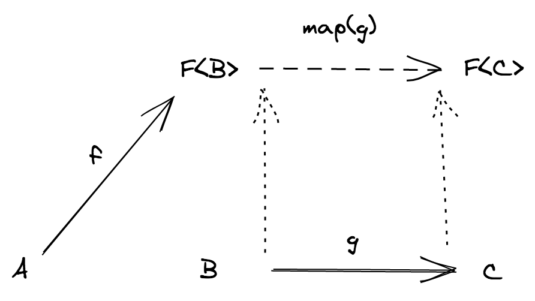
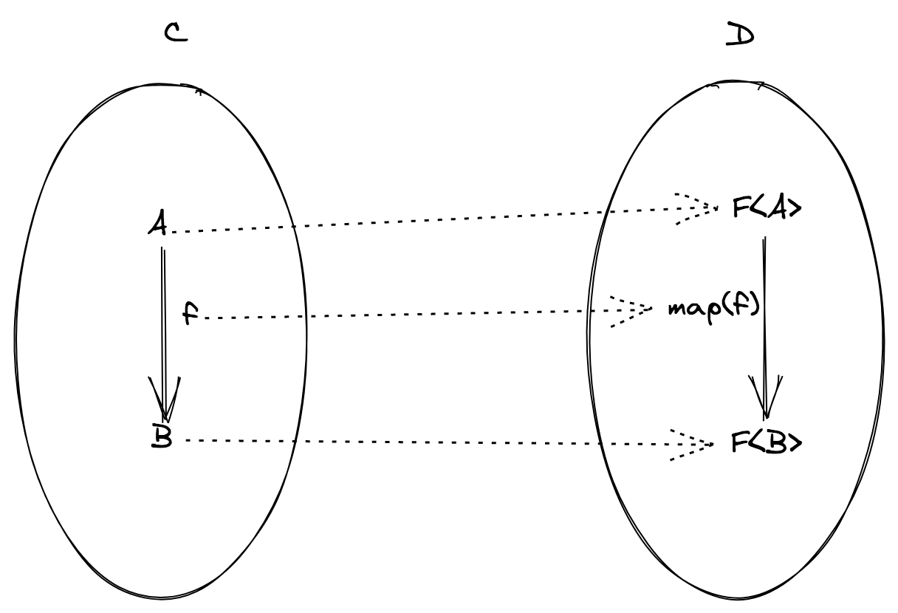
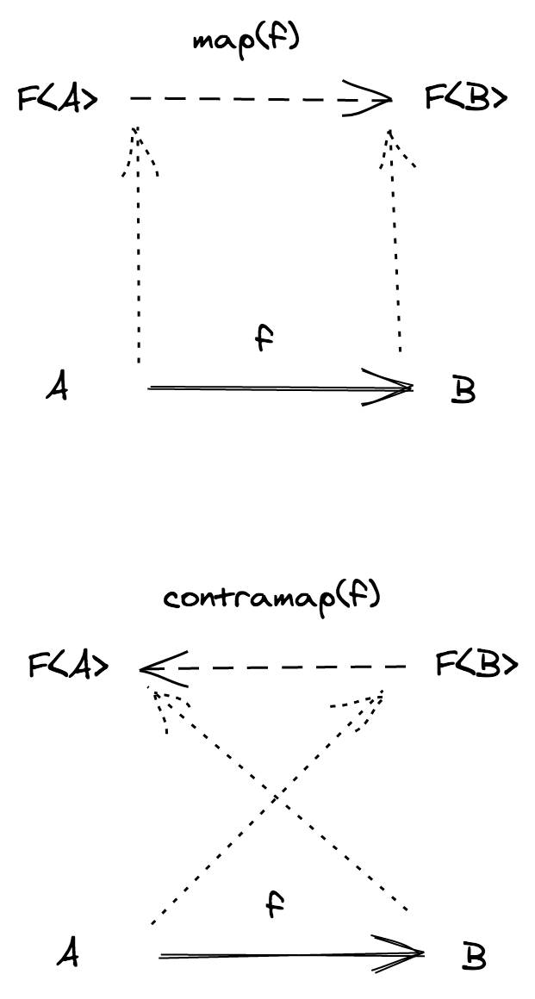

# Funktori

> [!NOTE]
> Poglavlje 11 originalnog prevoda. Tekst je neizmenjen — prilagođene su samo putanje do slika i koda i interne veze između poglavlja. [Sadržaj originalnog prevoda](index.md)
>
> Prerada ovog poglavlja planirana je u Celini 4 — Apstrakcije i kompozicija (vidi [mapu sadržaja](../mapa-sadrzaja.md)). Pojedini delovi već su korišćeni u lekcijama: [Sporedni efekti](../01-osnove/03-sporedni-efekti.md).


U prethodnom poglavlju predstavljena je kategorija _TS_ (kategorija TypeScript-a) i centralni problem kompozicije funkcija:

> Kako možemo da komponujemo dve generičke funkcije `f: (a: A) => B` i `g: (c: C) => D`?

Ali zašto je toliko važno pronaći rešenja za ovaj problem?

Zato što, ako je tačno da se kategorije mogu koristiti za modelovanje programskih jezika, morfizmi (tj. funkcije u _TS_) mogu se koristiti za modelovanje **programa**.

Stoga rešavanje tog apstraktnog problema znači i pronalaženje načina da se **programi komponuju na generički način**.
A _to_ je zaista veoma zanimljivo za jednog programera, zar ne?

## Funkcije kao programi

Ako želimo da koristimo funkcije za modelovanje programa, odmah moramo da se suočimo sa jednim problemom:

> Kako je moguće čistom funkcijom modelovati program koji proizvodi sporedne efekte?

Odgovor je da se sporedni efekti modeluju pomoću onoga što nazivamo **efektima**, odnosno pomoću tipova koji **predstavljaju** sporedne efekte.

Pogledajmo dve moguće tehnike da se to uradi u JavaScript-u:

- definisati DSL (domain specific language) za efekte
- koristiti _thunk_-ove

Prva tehnika, dakle korišćenje DSL-a, znači izmeniti program kao što je:

```ts
const log = (message: string): void => {
  console.log(message) // sporedni efekat
}
```

menjajući njegov kodomen tako da postane funkcija koja vraća **opis** sporednog efekta:

```ts
type DSL = ... // tip sume svih mogućih efekata kojima upravlja sistem

const log = (message: string): DSL => {
  return { _tag: 'log', message } // efekat koji opisuje čin pisanja na konzolu
}
```

**Kviz** (JavaScript). Da li je upravo definisana funkcija `log` zaista čista? A ipak `log('foo') !== log('foo')`!

Ova prva tehnika pretpostavlja postojanje načina za kombinovanje efekata, kao i definiciju interpretera koji je u stanju da konkretno izvrši efekte kada želimo da pokrenemo konačni program.

Druga tehnika, jednostavnija i izvodljiva u TypeScript-u, jeste da se izračunavanje obavije u _thunk_:

```ts
// thunk koji predstavlja sinhroni sporedni efekat
type IO<A> = () => A

const log = (message: string): IO<void> => {
  return () => console.log(message) // vraća thunk
}
```

Program `log`, kada se izvrši, ne izaziva odmah sporedni efekat, već vraća **vrednost koja predstavlja izračunavanje**.

```ts
import { IO } from 'fp-ts/IO'

export const log = (message: string): IO<void> => {
  return () => console.log(message) // vraća thunk
}

export const main = log('hello!')
// u ovom trenutku ne vidim ništa na konzoli
// zato što je `main` samo inertna vrednost
// koja predstavlja izračunavanje

main()
// tek kada eksplicitno pokrenem program
// vidim rezultat na konzoli
```

U funkcionalnom programiranju sporedni efekti (u obliku efekata) obično se potiskuju na granice sistema (tj. u funkciju `main`),
gde se izvršavaju, pa se tako dobija sledeća šema:

> system = pure core + imperative shell

U _čisto funkcionalnim_ jezicima (kao što su Haskell, PureScript ili Elm) ova podela je jasna i nameće je sam jezik.

I uz ovu drugu tehniku (onu koju koristi `fp-ts`) potreban je način za kombinovanje efekata, što nas vraća našoj želji da programe komponujemo na generički način; pogledajmo kako se to radi.

Pre svega, malo (neformalne) terminologije: **čistim programom** nazivamo funkciju sa sledećim potpisom:

```
(a: A) => B
```

Takav potpis modeluje program koji prihvata ulaz tipa `A` i vraća rezultat tipa `B`, bez ikakvog efekta.

**Primer**

Program `len`:

```ts
const len = (s: string): number => s.length
```

**Programom sa efektima** nazivamo funkciju sa sledećim potpisom:

```
(a: A) => F<B>
```

za neki konstruktor tipa `F`.

Podsetimo se da je [konstruktor tipa](https://en.wikipedia.org/wiki/Type_constructor) `n`-arni operator na nivou tipova koji kao argument prima nula ili više tipova i vraća tip (primeri: `Option`, `ReadonlyArray`).

Takav potpis modeluje program koji prihvata ulaz tipa `A` i vraća rezultat tipa `B` zajedno sa **efektom** `F`.

**Primer**

Program `head`

```ts
import { Option, some, none } from 'fp-ts/Option'

const head = <A>(as: ReadonlyArray<A>): Option<A> =>
  as.length === 0 ? none : some(as[0])
```

je program sa efektom `Option`.

Kada govorimo o efektima, zanimaju nas `n`-arni konstruktori tipa sa `n >= 1`, na primer:

| Type constructor   | Effect (interpretation)                        |
| ------------------ | ---------------------------------------------- |
| `ReadonlyArray<A>` | a non deterministic computation                |
| `Option<A>`        | a computation that may fail                    |
| `Either<E, A>`     | a computation that may fail                    |
| `IO<A>`            | a synchronous computation that **never fails** |
| `Task<A>`          | an asynchronous computation **never fails**    |
| `Reader<R, A>`     | reading from an environment                    |

gde je

```ts
// thunk koji vraća `Promise`
type Task<A> = () => Promise<A>
```

```ts
// `R` represents an "environment" needed for the computation
// (we can "read" from it) and `A` is the result
type Reader<R, A> = (r: R) => A
```

Vratimo se sada našem glavnom problemu:

> Kako možemo da komponujemo dve generičke funkcije `f: (a: A) => B` i `g: (c: C) => D`?

Pošto opšti problem nije moguće rešiti, moramo da uvedemo neko **ograničenje** za `B` i `C`.

Već znamo da je, ako je `B = C`, rešenje uobičajena kompozicija funkcija

```ts
function flow<A, B, C>(f: (a: A) => B, g: (b: B) => C): (a: A) => C {
  return (a) => g(f(a))
}
```

Ali šta raditi u ostalim slučajevima?

## Ograničenje koje vodi do funktora

Razmotrimo sledeće ograničenje: `B = F<C>` za neki konstruktor tipa `F`; tako imamo sledeću situaciju:

- `f: (a: A) => F<B>` je program sa efektima
- `g: (b: B) => C` je čist program

Da bismo mogli da komponujemo `f` sa `g`, moramo da pronađemo postupak koji omogućava da se `g` pretvori iz funkcije `(b: B) => C` u funkciju `(fb: F<B>) => F<C>`, tako da možemo da koristimo običnu kompoziciju funkcija (naime, na taj način bi kodomen funkcije `f` bio isti skup koji je domen nove funkcije).



Tako smo originalni problem pretvorili u novi i drugačiji: da li možemo da pronađemo funkciju, nazovimo je `map`, koja deluje na ovaj način?

Pogledajmo nekoliko praktičnih primera:

**Primer** (`F = ReadonlyArray`)

```ts
import { flow, pipe } from 'fp-ts/function'

// transformiše funkcije `B -> C` u funkcije `ReadonlyArray<B> -> ReadonlyArray<C>`
const map = <B, C>(g: (b: B) => C) => (
  fb: ReadonlyArray<B>
): ReadonlyArray<C> => fb.map(g)

// -------------------
// primer upotrebe
// -------------------

interface User {
  readonly id: number
  readonly name: string
  readonly followers: ReadonlyArray<User>
}

const getFollowers = (user: User): ReadonlyArray<User> => user.followers
const getName = (user: User): string => user.name

// getFollowersNames: User -> ReadonlyArray<string>
const getFollowersNames = flow(getFollowers, map(getName))

// ili, ako vam je draže da koristite `pipe` umesto `flow`...
export const getFollowersNames2 = (user: User) =>
  pipe(user, getFollowers, map(getName))

const user: User = {
  id: 1,
  name: 'Ruth R. Gonzalez',
  followers: [
    { id: 2, name: 'Terry R. Emerson', followers: [] },
    { id: 3, name: 'Marsha J. Joslyn', followers: [] }
  ]
}

console.log(getFollowersNames(user)) // => [ 'Terry R. Emerson', 'Marsha J. Joslyn' ]
```

**Primer** (`F = Option`)

```ts
import { flow } from 'fp-ts/function'
import { none, Option, match, some } from 'fp-ts/Option'

// transformiše funkcije `B -> C` u funkcije `Option<B> -> Option<C>`
const map = <B, C>(g: (b: B) => C): ((fb: Option<B>) => Option<C>) =>
  match(
    () => none,
    (b) => {
      const c = g(b)
      return some(c)
    }
  )

// -------------------
// primer upotrebe
// -------------------

import * as RA from 'fp-ts/ReadonlyArray'

const head: (input: ReadonlyArray<number>) => Option<number> = RA.head
const double = (n: number): number => n * 2

// getDoubleHead: ReadonlyArray<number> -> Option<number>
const getDoubleHead = flow(head, map(double))

console.log(getDoubleHead([1, 2, 3])) // => some(2)
console.log(getDoubleHead([])) // => none
```

**Primer** (`F = IO`)

```ts
import { flow } from 'fp-ts/function'
import { IO } from 'fp-ts/IO'

// transformiše funkcije `B -> C` u funkcije `IO<B> -> IO<C>`
const map = <B, C>(g: (b: B) => C) => (fb: IO<B>): IO<C> => () => {
  const b = fb()
  return g(b)
}

// -------------------
// primer upotrebe
// -------------------

interface User {
  readonly id: number
  readonly name: string
}

// a dummy in memory database
const database: Record<number, User> = {
  1: { id: 1, name: 'Ruth R. Gonzalez' },
  2: { id: 2, name: 'Terry R. Emerson' },
  3: { id: 3, name: 'Marsha J. Joslyn' }
}

const getUser = (id: number): IO<User> => () => database[id]
const getName = (user: User): string => user.name

// getUserName: number -> IO<string>
const getUserName = flow(getUser, map(getName))

console.log(getUserName(1)()) // => Ruth R. Gonzalez
```

**Primer** (`F = Task`)

```ts
import { flow } from 'fp-ts/function'
import { Task } from 'fp-ts/Task'

// transformiše funkcije `B -> C` u funkcije `Task<B> -> Task<C>`
const map = <B, C>(g: (b: B) => C) => (fb: Task<B>): Task<C> => () => {
  const promise = fb()
  return promise.then(g)
}

// -------------------
// primer upotrebe
// -------------------

interface User {
  readonly id: number
  readonly name: string
}

// a dummy remote database
const database: Record<number, User> = {
  1: { id: 1, name: 'Ruth R. Gonzalez' },
  2: { id: 2, name: 'Terry R. Emerson' },
  3: { id: 3, name: 'Marsha J. Joslyn' }
}

const getUser = (id: number): Task<User> => () => Promise.resolve(database[id])
const getName = (user: User): string => user.name

// getUserName: number -> Task<string>
const getUserName = flow(getUser, map(getName))

getUserName(1)().then(console.log) // => Ruth R. Gonzalez
```

**Primer** (`F = Reader`)

```ts
import { flow } from 'fp-ts/function'
import { Reader } from 'fp-ts/Reader'

// transformiše funkcije `B -> C` u funkcije `Reader<R, B> -> Reader<R, C>`
const map = <B, C>(g: (b: B) => C) => <R>(fb: Reader<R, B>): Reader<R, C> => (
  r
) => {
  const b = fb(r)
  return g(b)
}

// -------------------
// primer upotrebe
// -------------------

interface User {
  readonly id: number
  readonly name: string
}

interface Env {
  // a dummy in memory database
  readonly database: Record<string, User>
}

const getUser = (id: number): Reader<Env, User> => (env) => env.database[id]
const getName = (user: User): string => user.name

// getUserName: number -> Reader<Env, string>
const getUserName = flow(getUser, map(getName))

console.log(
  getUserName(1)({
    database: {
      1: { id: 1, name: 'Ruth R. Gonzalez' },
      2: { id: 2, name: 'Terry R. Emerson' },
      3: { id: 3, name: 'Marsha J. Joslyn' }
    }
  })
) // => Ruth R. Gonzalez
```

Uopšteno govoreći, kada za neki konstruktor tipa `F` postoji `map` koja deluje na ovaj način, kažemo da on ima **instancu funktora**.

Sa matematičke tačke gledišta, funktori su **preslikavanja između kategorija** koja čuvaju kategorijsku strukturu, odnosno čuvaju morfizme identiteta i operaciju kompozicije.

Pošto se kategorije sastoje od dve stvari (objekata i morfizama), i funktor se sastoji od dve stvari:

- **preslikavanja između objekata** koje svakom objektu `X` u _C_ pridružuje objekat `F<X>` u _D_
- **preslikavanja između morfizama** koje svakom morfizmu `f` u _C_ pridružuje morfizam `map(f)` u _D_

gde su _C_ i _D_ dve kategorije (alias dva programska jezika).



Iako je preslikavanje između dva programska jezika intrigantna ideja, više nas zanima preslikavanje u kojem se _C_ i _D_ poklapaju (sa kategorijom _TS_). U tom slučaju govorimo o **endofunktorima** ("endo" znači "unutar", "unutrašnji").

Od sada, ako nije drugačije naznačeno, kada napišem "funktor" mislim na endofunktor u _TS_.

Sada kada znamo koji nas praktični aspekt funktora zanima, pogledajmo njihovu formalnu definiciju.

**Definicija**. Funktor je par `(F, map)` gde je:

- `F` `n`-arni (`n >= 1`) konstruktor tipa koji svaki tip `X` preslikava u tip `F<X>` (**preslikavanje između objekata**)
- `map` funkcija sa sledećim potpisom:

```ts
map: <A, B>(f: (a: A) => B) => ((fa: F<A>) => F<B>)
```

koja svaku funkciju `f: (a: A) => B` preslikava u funkciju `map(f): (fa: F<A>) => F<B>` (**preslikavanje između morfizama**)

Moraju da važe sledeći zakoni:

- `map(1`<sub>X</sub>`)` = `1`<sub>F(X)</sub> (**identiteti se preslikavaju u identitete**)
- `map(g ∘ f) = map(g) ∘ map(f)` (**slika kompozicije je kompozicija slika**)

Drugi zakon vam omogućava da refaktorisanjem optimizujete izračunavanje:

```ts
import { flow, increment, pipe } from 'fp-ts/function'
import { map } from 'fp-ts/ReadonlyArray'

const double = (n: number): number => n * 2

// dva prolaza kroz niz
console.log(pipe([1, 2, 3], map(double), map(increment))) // => [ 3, 5, 7 ]

// samo jedan prolaz kroz niz
console.log(pipe([1, 2, 3], map(flow(double, increment)))) // => [ 3, 5, 7 ]
```

## Funktori i funkcionalno rukovanje greškama

Funktori imaju pozitivan uticaj na funkcionalno rukovanje greškama; pogledajmo praktičan primer:

```ts
declare const doSomethingWithIndex: (index: number) => string

export const program = (ns: ReadonlyArray<number>): string => {
  // rezultat -1 označava da nijedan element nije pronađen
  const i = ns.findIndex((n) => n > 0)
  if (i !== -1) {
    return doSomethingWithIndex(i)
  }
  throw new Error('cannot find a positive number')
}
```

Kada koristimo nativni API `findIndex`, da bismo nastavili tok programa moramo da proverimo parcijalni rezultat pomoću `if` (pod uslovom da se toga setimo! Rezultat `findIndex` može nehotice da bude prosleđen kao ulaz funkciji `doSomethingWithIndex`).

Pogledajmo umesto toga kako se analogan rezultat može lakše postići korišćenjem `Option` i njegove instance funktora:

```ts
import { pipe } from 'fp-ts/function'
import { map, Option } from 'fp-ts/Option'
import { findIndex } from 'fp-ts/ReadonlyArray'

declare const doSomethingWithIndex: (index: number) => string

export const program = (ns: ReadonlyArray<number>): Option<string> =>
  pipe(
    ns,
    findIndex((n) => n > 0),
    map(doSomethingWithIndex)
  )
```

U praksi, kada koristimo `Option`, pred sobom uvek imamo _happy path_, a rukovanje greškom odvija se iza scene zahvaljujući njegovoj funkciji `map`.

**Kviz**. `Task<A>` predstavlja asinhrono izračunavanje koje ne može da se završi neuspehom; kako bismo onda modelovali asinhrono izračunavanje koje može da se završi neuspehom?

## Funktori se komponuju

Funktori se komponuju, tj. ako su data dva funktora `F` i `G`, onda je i kompozicija `F<G<A>>` funktor, a `map` kompozicije je kompozicija `map` funkcija.

**Primer** (`F = Task`, `G = Option`)

```ts
import { flow } from 'fp-ts/function'
import * as O from 'fp-ts/Option'
import * as T from 'fp-ts/Task'

type TaskOption<A> = T.Task<O.Option<A>>

export const map: <A, B>(
  f: (a: A) => B
) => (fa: TaskOption<A>) => TaskOption<B> = flow(O.map, T.map)

// -------------------
// primer upotrebe
// -------------------

interface User {
  readonly id: number
  readonly name: string
}

// a dummy remote database
const database: Record<number, User> = {
  1: { id: 1, name: 'Ruth R. Gonzalez' },
  2: { id: 2, name: 'Terry R. Emerson' },
  3: { id: 3, name: 'Marsha J. Joslyn' }
}

const getUser = (id: number): TaskOption<User> => () =>
  Promise.resolve(O.fromNullable(database[id]))
const getName = (user: User): string => user.name

// getUserName: number -> TaskOption<string>
const getUserName = flow(getUser, map(getName))

getUserName(1)().then(console.log) // => some('Ruth R. Gonzalez')
getUserName(4)().then(console.log) // => none
```

## Kontravarijantni funktori

Pre nego što nastavimo, želim da vam pokažem jednu varijantu koncepta funktora koji smo videli u prethodnom odeljku: **kontravarijantne funktore**.

Da budemo sasvim precizni, ono što smo do sada jednostavno nazivali "funktorima" trebalo bi ispravnije nazivati **kovarijantnim funktorima**.

Definicija kontravarijantnog funktora potpuno je analogna definiciji kovarijantnog funktora, osim potpisa njegove osnovne operacije (koja se naziva `contramap` umesto `map`)



**Primer**

```ts
import { map } from 'fp-ts/Option'
import { contramap } from 'fp-ts/Eq'

type User = {
  readonly id: number
  readonly name: string
}

const getId = (_: User): number => _.id

// kako radi `map`...
// const getIdOption: (fa: Option<User>) => Option<number>
const getIdOption = map(getId)

// kako radi `contramap`...
// const getIdEq: (fa: Eq<number>) => Eq<User>
const getIdEq = contramap(getId)

import * as N from 'fp-ts/number'

const EqID = getIdEq(N.Eq)

/*

U poglavlju o `Eq` uradili smo:

const EqID: Eq<User> = pipe(
  N.Eq,
  contramap((_: User) => _.id)
)
*/
```

## Funktori u `fp-ts`

Kako da definišemo instancu funktora u `fp-ts`? Pogledajmo nekoliko praktičnih primera.

Sledeća deklaracija definiše model odgovora na poziv nekog API-ja:

```ts
interface Response<A> {
  readonly url: string
  readonly status: number
  readonly headers: Record<string, string>
  readonly body: A
}
```

Primetite da je polje `body` parametarsko; ta činjenica čini `Response` dobrim kandidatom za traženje instance funktora, pošto je `Response` `n`-arni konstruktor tipa sa `n >= 1` (neophodan uslov).

Da bismo mogli da definišemo instancu funktora za `Response`, moramo da definišemo funkciju `map` zajedno sa nekim [tehničkim detaljima](https://gcanti.github.io/fp-ts/recipes/HKT.html) koje zahteva `fp-ts`.

```ts
// `Response.ts` module

import { pipe } from 'fp-ts/function'
import { Functor1 } from 'fp-ts/Functor'

declare module 'fp-ts/HKT' {
  interface URItoKind<A> {
    readonly Response: Response<A>
  }
}

export interface Response<A> {
  readonly url: string
  readonly status: number
  readonly headers: Record<string, string>
  readonly body: A
}

export const map = <A, B>(f: (a: A) => B) => (
  fa: Response<A>
): Response<B> => ({
  ...fa,
  body: f(fa.body)
})

// functor instance for `Response<A>`
export const Functor: Functor1<'Response'> = {
  URI: 'Response',
  map: (fa, f) => pipe(fa, map(f))
}
```

## Da li funktori rešavaju centralni problem?

Još ne. Funktori nam omogućavaju da komponujemo program sa efektima `f` sa čistim programom `g`, ali `g` mora biti **unarna** funkcija, odnosno funkcija koja prihvata samo jedan argument. Šta se dešava ako `g` prihvata dva ili više argumenata?

| Program f | Program g               | Composition  |
| --------- | ----------------------- | ------------ |
| pure      | pure                    | `g ∘ f`      |
| effectful | pure (unary)            | `map(g) ∘ f` |
| effectful | pure (`n`-ary, `n > 1`) | ?            |

Da bismo izašli na kraj sa ovom situacijom, potrebno nam je nešto više; u sledećem poglavlju videćemo još jednu važnu apstrakciju funkcionalnog programiranja: **aplikativne funktore**.

---

[← Prethodno poglavlje](10-teorija-kategorija.md) · [Sadržaj](index.md) · [Sledeće poglavlje →](12-aplikativni-funktori.md)
