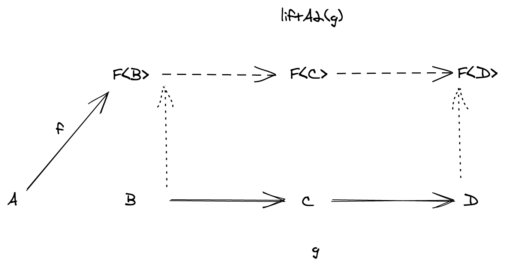
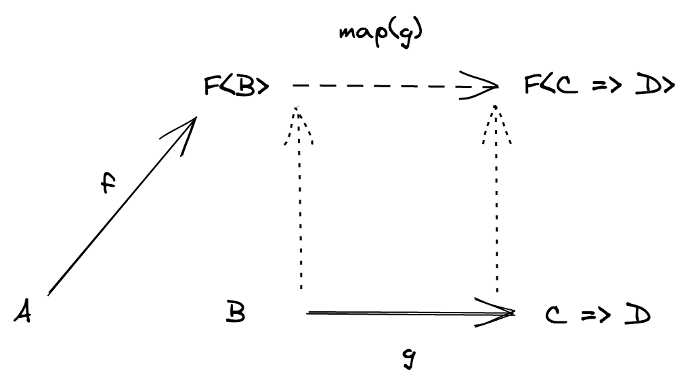

# Aplikativni funktori

> [!NOTE]
> Poglavlje 12 originalnog prevoda. Tekst je neizmenjen — prilagođene su samo putanje do slika i koda i interne veze između poglavlja. [Sadržaj originalnog prevoda](index.md)
>
> Prerada ovog poglavlja planirana je u Celini 4 — Apstrakcije i kompozicija (vidi [mapu sadržaja](../mapa-sadrzaja.md)). Pojedini delovi već su korišćeni u lekcijama: [`pipe` i `flow`](../01-osnove/07-pipe-i-flow.md).


U odeljku o funktorima videli smo da možemo da komponujemo program sa efektima `f: (a: A) => F<B>` sa čistim programom `g: (b: B) => C` tako što `g` transformišemo u funkciju `map(g): (fb: F<B>) => F<C>`, pod uslovom da `F` ima instancu funktora.

| Program f | Program g    | Composition  |
| --------- | ------------ | ------------ |
| pure      | pure         | `g ∘ f`      |
| effectful | pure (unary) | `map(g) ∘ f` |

Međutim, `g` mora da bude unarna, odnosno mora da prima samo jedan ulazni parametar. Šta se dešava ako `g` prima dva parametra? Možemo li i dalje da transformišemo `g` koristeći samo instancu funktora?

## Currying

Pre svega, treba da modelujemo funkciju koja prima dva parametra, recimo tipa `B` i `C`, i vraća vrednost tipa `D`:

```ts
g: (b: B, c: C) => D
```

Možemo da prepišemo `g` koristeći tehniku koja se zove **currying**.

> Currying is the technique of translating the evaluation of a function that takes multiple parameters into evaluating a sequence of functions, **each with a single parameter**. For example, a function that takes two parameters, one from `B` and one from `C`, and produces outputs in `D`, by currying is translated into a function that takes a single parameter from `B` and produces as outputs functions from `C` to `D`.

(source: [currying on wikipedia.org](https://en.wikipedia.org/wiki/Currying))

Dakle, pomoću currying-a možemo da prepišemo `g` kao:

```ts
g: (b: B) => (c: C) => D
```

**Primer**

```ts
interface User {
  readonly id: number
  readonly name: string
  readonly followers: ReadonlyArray<User>
}

const addFollower = (follower: User, user: User): User => ({
  ...user,
  followers: [...user.followers, follower]
})
```

Prepišimo `addFollower` pomoću currying-a

```ts
interface User {
  readonly id: number
  readonly name: string
  readonly followers: ReadonlyArray<User>
}

const addFollower = (follower: User) => (user: User): User => ({
  ...user,
  followers: [...user.followers, follower]
})

// -------------------
// primer upotrebe
// -------------------

const user: User = { id: 1, name: 'Ruth R. Gonzalez', followers: [] }
const follower: User = { id: 3, name: 'Marsha J. Joslyn', followers: [] }

console.log(addFollower(follower)(user))
/*
{
  id: 1,
  name: 'Ruth R. Gonzalez',
  followers: [ { id: 3, name: 'Marsha J. Joslyn', followers: [] } ]
}
*/
```

## Operacija `ap`

Pretpostavimo sada:

- da nemamo na raspolaganju `follower`, već samo njegov `id`
- da nemamo na raspolaganju `user`, već samo njegov `id`
- da imamo na raspolaganju API `fetchUser` koji, za dati `id`, poziva endpoint koji vraća odgovarajući `User`

```ts
import * as T from 'fp-ts/Task'

interface User {
  readonly id: number
  readonly name: string
  readonly followers: ReadonlyArray<User>
}

const addFollower = (follower: User) => (user: User): User => ({
  ...user,
  followers: [...user.followers, follower]
})

declare const fetchUser: (id: number) => T.Task<User>

const userId = 1
const followerId = 3

const result = addFollower(fetchUser(followerId))(fetchUser(userId)) // ne kompajlira se!
```

Više ne mogu da koristim `addFollower`! Kako da nastavimo?

Kada bismo imali na raspolaganju funkciju sa sledećim potpisom:

```ts
declare const addFollowerAsync: (
  follower: T.Task<User>
) => (user: T.Task<User>) => T.Task<User>
```

mogli bismo lako da nastavimo:

```ts
import * as T from 'fp-ts/Task'

interface User {
  readonly id: number
  readonly name: string
  readonly followers: ReadonlyArray<User>
}

declare const fetchUser: (id: number) => T.Task<User>

declare const addFollowerAsync: (
  follower: T.Task<User>
) => (user: T.Task<User>) => T.Task<User>

const userId = 1
const followerId = 3

// const result: T.Task<User>
const result = addFollowerAsync(fetchUser(followerId))(fetchUser(userId)) // sada se kompajlira
```

Naravno, možemo da pokušamo da ručno implementiramo `addFollowerAsync`, ali da li je umesto toga moguće pronaći transformaciju koja, polazeći od funkcije kao što je `addFollower: (follower: User) => (user: User): User`, vraća funkciju kao što je `addFollowerAsync: (follower: Task<User>) => (user: Task<User>) => Task<User>`?

Uopštenije, ono što bismo želeli jeste transformacija, nazovimo je `liftA2`, koja polazeći od funkcije `g: (b: B) => (c: C) => D` vraća funkciju sa sledećim potpisom:

```ts
liftA2(g): (fb: F<B>) => (fc: F<C>) => F<D>
```



Kako da je dobijemo? Pošto je `g` sada unarna, možemo da iskoristimo instancu funktora i našu staru funkciju `map`:

```ts
map(g): (fb: F<B>) => F<(c: C) => D>
```



Ali sada smo zaglavljeni: instanca funktora ne pruža nijednu legalnu operaciju koja bi nam omogućila da "raspakujemo" tip `F<(c: C) => D>` u tip `(fc: F<C>) => F<D>`.

Zato uvodimo novu operaciju `ap` koja ostvaruje to raspakivanje:

```ts
declare const ap: <A>(fa: Task<A>) => <B>(fab: Task<(a: A) => B>) => Task<B>
```

**Napomena**. Zašto baš ime "ap"? Zato što se može posmatrati kao neka vrsta primene funkcije

```ts
// `apply` primenjuje funkciju na vrednost
declare const apply: <A>(a: A) => <B>(f: (a: A) => B) => B

declare const ap: <A>(a: Task<A>) => <B>(f: Task<(a: A) => B>) => Task<B>
// `ap` primenjuje funkciju upakovanu u efekat na vrednost upakovanu u efekat
```

Sada, kada imamo operaciju `ap`, možemo da definišemo `liftA2`:

```ts
import { pipe } from 'fp-ts/function'
import * as T from 'fp-ts/Task'

const liftA2 = <B, C, D>(g: (b: B) => (c: C) => D) => (fb: T.Task<B>) => (
  fc: T.Task<C>
): T.Task<D> => pipe(fb, T.map(g), T.ap(fc))

interface User {
  readonly id: number
  readonly name: string
  readonly followers: ReadonlyArray<User>
}

const addFollower = (follower: User) => (user: User): User => ({
  ...user,
  followers: [...user.followers, follower]
})

// const addFollowerAsync: (fb: T.Task<User>) => (fc: T.Task<User>) => T.Task<User>
const addFollowerAsync = liftA2(addFollower)
```

i na kraju, da komponujemo `fetchUser` sa prethodnim rezultatom:

```ts
import { flow, pipe } from 'fp-ts/function'
import * as T from 'fp-ts/Task'

const liftA2 = <B, C, D>(g: (b: B) => (c: C) => D) => (fb: T.Task<B>) => (
  fc: T.Task<C>
): T.Task<D> => pipe(fb, T.map(g), T.ap(fc))

interface User {
  readonly id: number
  readonly name: string
  readonly followers: ReadonlyArray<User>
}

const addFollower = (follower: User) => (user: User): User => ({
  ...user,
  followers: [...user.followers, follower]
})

declare const fetchUser: (id: number) => T.Task<User>

// const program: (id: number) => (fc: T.Task<User>) => T.Task<User>
const program = flow(fetchUser, liftA2(addFollower))

const userId = 1
const followerId = 3

// const result: T.Task<User>
const result = program(followerId)(fetchUser(userId))
```

Pronašli smo standardnu proceduru za kompoziciju dve funkcije `f: (a: A) => F<B>`, `g: (b: B, c: C) => D`:

1. `g` se pomoću currying-a transformiše u funkciju `g: (b: B) => (c: C) => D`
2. definiše se funkcija `ap` za efekat `F` (bibliotečka funkcija)
3. definiše se pomoćna (utility) funkcija `liftA2` za efekat `F` (bibliotečka funkcija)
4. kompozicija se dobija pomoću `flow(f, liftA2(g))`

Pogledajmo kako je definisana operacija `ap` za neke već poznate konstruktore tipa:

**Primer** (`F = ReadonlyArray`)

```ts
import { increment, pipe } from 'fp-ts/function'

const ap = <A>(fa: ReadonlyArray<A>) => <B>(
  fab: ReadonlyArray<(a: A) => B>
): ReadonlyArray<B> => {
  const out: Array<B> = []
  for (const f of fab) {
    for (const a of fa) {
      out.push(f(a))
    }
  }
  return out
}

const double = (n: number): number => n * 2

pipe([double, increment], ap([1, 2, 3]), console.log) // => [ 2, 4, 6, 2, 3, 4 ]
```

**Primer** (`F = Option`)

```ts
import { pipe } from 'fp-ts/function'
import * as O from 'fp-ts/Option'

const ap = <A>(fa: O.Option<A>) => <B>(
  fab: O.Option<(a: A) => B>
): O.Option<B> =>
  pipe(
    fab,
    O.match(
      () => O.none,
      (f) =>
        pipe(
          fa,
          O.match(
            () => O.none,
            (a) => O.some(f(a))
          )
        )
    )
  )

const double = (n: number): number => n * 2

pipe(O.some(double), ap(O.some(1)), console.log) // => some(2)
pipe(O.some(double), ap(O.none), console.log) // => none
pipe(O.none, ap(O.some(1)), console.log) // => none
pipe(O.none, ap(O.none), console.log) // => none
```

**Primer** (`F = IO`)

```ts
import { IO } from 'fp-ts/IO'

const ap = <A>(fa: IO<A>) => <B>(fab: IO<(a: A) => B>): IO<B> => () => {
  const f = fab()
  const a = fa()
  return f(a)
}
```

**Primer** (`F = Task`)

```ts
import { Task } from 'fp-ts/Task'

const ap = <A>(fa: Task<A>) => <B>(fab: Task<(a: A) => B>): Task<B> => () =>
  Promise.all([fab(), fa()]).then(([f, a]) => f(a))
```

**Primer** (`F = Reader`)

```ts
import { Reader } from 'fp-ts/Reader'

const ap = <R, A>(fa: Reader<R, A>) => <B>(
  fab: Reader<R, (a: A) => B>
): Reader<R, B> => (r) => {
  const f = fab(r)
  const a = fa(r)
  return f(a)
}
```

Videli smo da pomoću `ap` možemo da radimo sa funkcijama koje imaju dva parametra, ali šta se dešava sa funkcijama koje primaju **tri** parametra? Da li nam je potrebna _još jedna apstrakcija_?

Dobra vest je da je odgovor ne, `map` + `ap` su dovoljni:

```ts
import { pipe } from 'fp-ts/function'
import * as T from 'fp-ts/Task'

const liftA3 = <B, C, D, E>(f: (b: B) => (c: C) => (d: D) => E) => (
  fb: T.Task<B>
) => (fc: T.Task<C>) => (fd: T.Task<D>): T.Task<E> =>
  pipe(fb, T.map(f), T.ap(fc), T.ap(fd))

const liftA4 = <B, C, D, E, F>(
  f: (b: B) => (c: C) => (d: D) => (e: E) => F
) => (fb: T.Task<B>) => (fc: T.Task<C>) => (fd: T.Task<D>) => (
  fe: T.Task<E>
): T.Task<F> => pipe(fb, T.map(f), T.ap(fc), T.ap(fd), T.ap(fe))

// itd...
```

Sada možemo da ažuriramo našu "tabelu kompozicije":

| Program f | Program g     | Composition     |
| --------- | ------------- | --------------- |
| pure      | pure          | `g ∘ f`         |
| effectful | pure (unary)  | `map(g) ∘ f`    |
| effectful | pure, `n`-ary | `liftAn(g) ∘ f` |

## Operacija `of`

Sada znamo da, ako imamo dve funkcije `f: (a: A) => F<B>`, `g: (b: B, c: C) => D`, možemo da dobijemo njihovu kompoziciju `h`:

```ts
h: (a: A) => (fc: F<C>) => F<D>
```

Da bismo izvršili `h`, potrebna nam je, dakle, vrednost tipa `A` i vrednost tipa `F<C>`.

Ali šta se dešava ako umesto vrednosti tipa `F<C>` za drugi parametar `fc` imamo na raspolaganju samo vrednost tipa `C`?

Bila bi korisna operacija koja može da transformiše vrednost tipa `C` u vrednost tipa `F<C>`, tako da zatim možemo da koristimo `h`.

Zato uvodimo takvu operaciju, nazvanu `of` (mogući sinonimi su **pure**, **return**):

```ts
declare const of: <C>(c: C) => F<C>
```

U literaturi se o **aplikativnim funktorima** govori za konstruktore tipa koji, pored `map`, podržavaju i obe operacije `ap` i `of`.

Pogledajmo kako je definisana operacija `of` za neke poznate konstruktore tipa:

**Primer** (`F = ReadonlyArray`)

```ts
const of = <A>(a: A): ReadonlyArray<A> => [a]
```

**Primer** (`F = Option`)

```ts
import * as O from 'fp-ts/Option'

const of = <A>(a: A): O.Option<A> => O.some(a)
```

**Primer** (`F = IO`)

```ts
import { IO } from 'fp-ts/IO'

const of = <A>(a: A): IO<A> => () => a
```

**Primer** (`F = Task`)

```ts
import { Task } from 'fp-ts/Task'

const of = <A>(a: A): Task<A> => () => Promise.resolve(a)
```

**Primer** (`F = Reader`)

```ts
import { Reader } from 'fp-ts/Reader'

const of = <R, A>(a: A): Reader<R, A> => () => a
```

## Aplikativni funktori se komponuju

Aplikativni funktori se komponuju, odnosno, za data dva aplikativna funktora `F` i `G`, njihova kompozicija `F<G<A>>` je i dalje aplikativni funktor.

**Primer** (`F = Task`, `G = Option`)

Operacija `of` kompozicije je kompozicija operacija `of`:

```ts
import { flow } from 'fp-ts/function'
import * as O from 'fp-ts/Option'
import * as T from 'fp-ts/Task'

type TaskOption<A> = T.Task<O.Option<A>>

const of: <A>(a: A) => TaskOption<A> = flow(O.of, T.of)
```

a operacija `ap` kompozicije dobija se po sledećem obrascu:

```ts
const ap = <A>(
  fa: TaskOption<A>
): (<B>(fab: TaskOption<(a: A) => B>) => TaskOption<B>) =>
  flow(
    T.map((gab) => (ga: O.Option<A>) => O.ap(ga)(gab)),
    T.ap(fa)
  )
```

## Da li aplikativni funktori rešavaju centralni problem?

Još ne. Preostaje još jedan, poslednji važan slučaj koji treba razmotriti: kada **oba** programa imaju efekte.

Još jednom nam je potrebno nešto više; u sledećem poglavlju govorićemo o jednoj od najvažnijih apstrakcija u funkcionalnom programiranju: o **monadama**.

---

[← Prethodno poglavlje](11-funktori.md) · [Sadržaj](index.md) · [Sledeće poglavlje →](13-monade.md)
