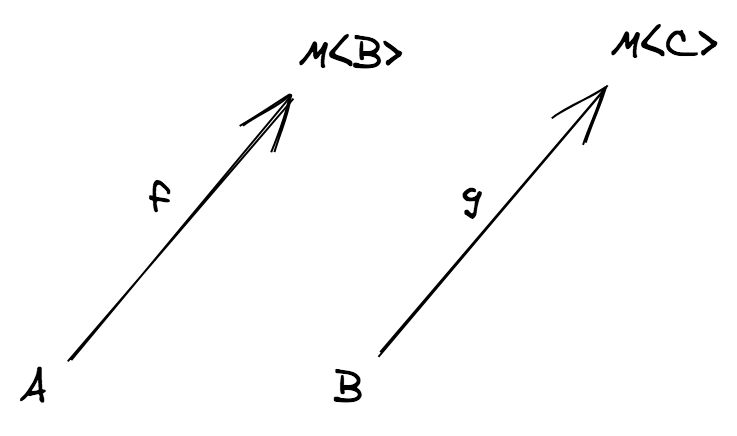
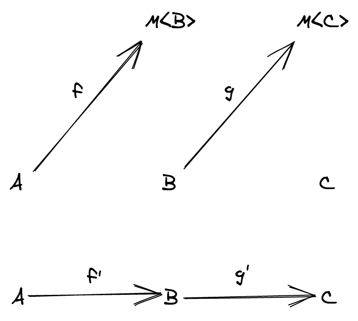
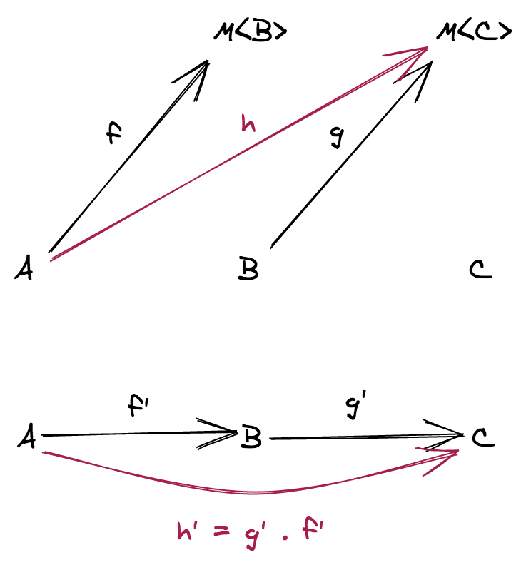
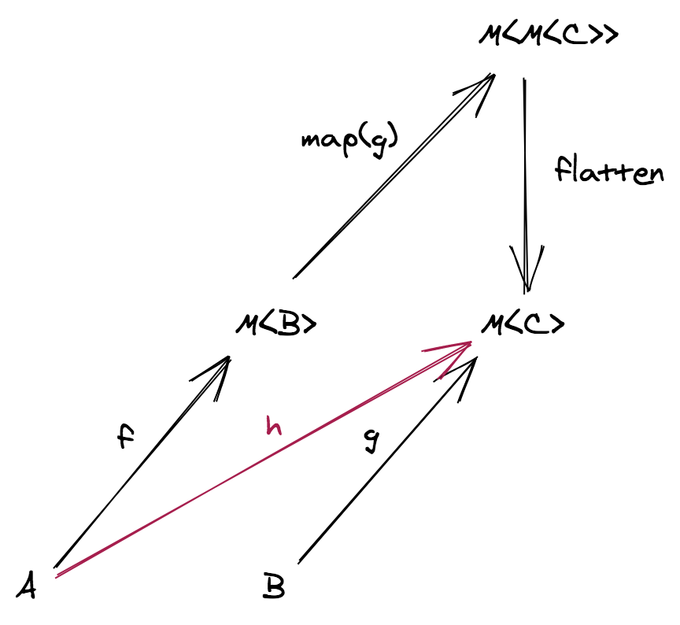
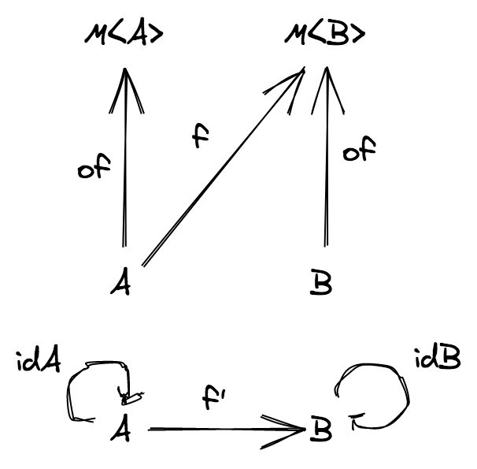

# Monade

> [!NOTE]
> Poglavlje 13 originalnog prevoda. Tekst je neizmenjen — prilagođene su samo putanje do slika i koda i interne veze između poglavlja. [Sadržaj originalnog prevoda](index.md)
>
> Prerada ovog poglavlja planirana je u Celini 5 — Monade i efekti (vidi [mapu sadržaja](../mapa-sadrzaja.md)).


<center>


(Eugenio Moggi is a professor of computer science at the University of Genoa, Italy. He first described the general use of monads to structure programs)


(Philip Lee Wadler is an American computer scientist known for his contributions to programming language design and type theory)

</center>

U prethodnom poglavlju videli smo da možemo da komponujemo program sa efektima `f: (a: A) => F<B>` sa čistim `n`-arnim programom `g`, pod uslovom da `F` ima instancu aplikativnog funktora:

| Program f | Program g     | Composition     |
| --------- | ------------- | --------------- |
| pure      | pure          | `g ∘ f`         |
| effectful | pure (unary)  | `map(g) ∘ f`    |
| effectful | pure, `n`-ary | `liftAn(g) ∘ f` |

Međutim, moramo da rešimo još jedan, poslednji (i čest) slučaj: kada **oba** programa imaju efekat:

```ts
f: (a: A) => F<B>
g: (b: B) => F<C>
```

Šta je kompozicija funkcija `f` i `g`?

## Problem ugnežđenih konteksta

Da bismo bolje pokazali zašto nam je potrebno nešto više, pogledajmo nekoliko primera.

**Primer** (`F = Array`)

Pretpostavimo da želimo da dobijemo pratioce pratilaca (followers of followers):

```ts
import { pipe } from 'fp-ts/function'
import * as A from 'fp-ts/ReadonlyArray'

interface User {
  readonly id: number
  readonly name: string
  readonly followers: ReadonlyArray<User>
}

const getFollowers = (user: User): ReadonlyArray<User> => user.followers

declare const user: User

// followersOfFollowers: ReadonlyArray<ReadonlyArray<User>>
const followersOfFollowers = pipe(user, getFollowers, A.map(getFollowers))
```

Nešto nije u redu: `followersOfFollowers` ima tip `ReadonlyArray<ReadonlyArray<User>>`, a mi bismo želeli `ReadonlyArray<User>`.

Potrebno je da izravnamo (**flatten**) ugnežđene nizove.

Funkcija `flatten: <A>(mma: ReadonlyArray<ReadonlyArray<A>>) => ReadonlyArray<A>` koju izvozi modul `fp-ts/ReadonlyArray` upravo je ono što nam treba:

```ts
// followersOfFollowers: ReadonlyArray<User>
const followersOfFollowers = pipe(
  user,
  getFollowers,
  A.map(getFollowers),
  A.flatten
)
```

Odlično! Pogledajmo sada neku drugu strukturu podataka.

**Primer** (`F = Option`)

Pretpostavimo da želimo da izračunamo recipročnu vrednost prvog elementa niza brojeva:

```ts
import { pipe } from 'fp-ts/function'
import * as O from 'fp-ts/Option'
import * as A from 'fp-ts/ReadonlyArray'

const inverse = (n: number): O.Option<number> =>
  n === 0 ? O.none : O.some(1 / n)

// inverseHead: O.Option<O.Option<number>>
const inverseHead = pipe([1, 2, 3], A.head, O.map(inverse))
```

Ups, opet se desilo: `inverseHead` ima tip `Option<Option<number>>`, a mi želimo `Option<number>`.

Potrebno je da izravnamo ugnežđene `Option` vrednosti.

Funkcija `flatten: <A>(mma: Option<Option<A>>) => Option<A>` koju izvozi modul `fp-ts/Option` upravo je ono što nam treba:

```ts
// inverseHead: O.Option<number>
const inverseHead = pipe([1, 2, 3], A.head, O.map(inverse), O.flatten)
```

Sve te funkcije `flatten`... Nisu slučajnost, iza kulisa se krije funkcionalni obrazac: oba konstruktora tipa, `ReadonlyArray` i `Option` (i mnogi drugi), imaju **instancu monade**, a

> `flatten` is the most peculiar operation of monads

**Napomena**. Mogući sinonim za `flatten` je **join**.

Dakle, šta je monada?

Evo kako se monade često predstavljaju...

## Definicija monade

**Definicija**. Monada je definisana sa tri stvari:

(1) konstruktorom tipa `M` koji ima instancu funktora

(2) funkcijom `of` (mogući sinonimi su **pure**, **return**) sa sledećim potpisom:

```ts
of: <A>(a: A) => M<A>
```

(3) funkcijom `chain` (mogući sinonimi su **flatMap**, **bind**) sa sledećim potpisom:

```ts
chain: <A, B>(f: (a: A) => M<B>) => (ma: M<A>) => M<B>
```

Funkcije `of` i `chain` moraju da poštuju tri zakona:

- `chain(of) ∘ f = f` (**Left identity**)
- `chain(f) ∘ of = f` (**Right identity**)
- `chain(h) ∘ (chain(g) ∘ f) = chain((chain(h) ∘ g)) ∘ f` (**Associativity**)

gde su `f`, `g`, `h` funkcije sa efektom `M`, a `∘` je uobičajena kompozicija funkcija.

Pri prvom susretu sa ovom definicijom u glavi mi se rojilo mnogo pitanja:

- zašto baš te dve operacije, `of` i `chain`? I zašto imaju baš takav potpis?
- zašto sinonimi "pure" i "flatMap"?
- zašto moraju da važe ti zakoni? Šta oni znače?
- ako je `flatten` toliko važan za monade, zašto se ne pojavljuje u njihovoj definiciji?

Ovo poglavlje će pokušati da odgovori na sva ta pitanja.

Vratimo se sada našem centralnom problemu: šta je kompozicija dve funkcije sa efektom, `f` i `g`?



<center>(dve Kleisli strelice)</center>

**Napomena**. Funkcija sa efektom naziva se i **Kleisli strelica** (**Kleisli arrow**).

Za sada ne znam čak ni koji **tip** takva kompozicija ima.

Samo trenutak... već smo se sreli sa apstrakcijom koja govori upravo o kompoziciji. Sećate li se šta smo rekli o kategorijama?

> Categories capture the essence of composition

Možemo li da pretvorimo naš problem u kategorijski problem, odnosno: možemo li da pronađemo kategoriju koja modeluje kompoziciju Kleisli strelica?

## Kleisli kategorija

<center>


(Heinrich Kleisli, Swiss mathematician)

</center>

Pokušajmo da konstruišemo kategoriju _K_ (koja se zove **Kleisli kategorija**) koja sadrži _samo_ Kleisli strelice:

- **objekti** su isti objekti kao u kategoriji _TS_, odnosno svi TypeScript tipovi.
- **morfizmi** se konstruišu ovako: svaki put kada u _TS_ postoji Kleisli strelica `f: A ⟼ M<B>`, u _K_ crtamo strelicu `f': A ⟼ B`

<center>


(gore kategorija _TS_, dole konstrukcija _K_)

</center>

Dakle, šta bi bila kompozicija `f` i `g` u _K_? To je crvena strelica nazvana `h'` na slici ispod:

<center>


(gore kategorija _TS_, dole konstrukcija _K_)

</center>

Pošto je `h'` strelica koja ide od `A` do `C` u `K`, možemo da joj pridružimo funkciju `h` koja ide od `A` do `M<C>` u `TS`.

Dakle, dobar kandidat za kompoziciju `f` i `g` u _TS_ je ponovo Kleisli strelica sa sledećim potpisom: `(a: A) => M<C>`.

Kako konkretno da konstruišemo takvu funkciju? Pa, hajde da pokušamo!

## Definicija operacije `chain` korak po korak

Tačka (1) definicije monade kaže nam da `M` ima instancu funktora, pa možemo da iskoristimo `map` da transformišemo funkciju `g: (b: B) => M<C>` u funkciju `map(g): (mb: M<B>) => M<M<C>>`

<center>


(kako dobiti funkciju `h`)

</center>

Ali sada smo zaglavljeni: instanca funktora nema nijednu legalnu operaciju koja bi nam omogućila da izravnamo vrednost tipa `M<M<C>>` u vrednost tipa `M<C>`; potrebna nam je dodatna operacija, nazovimo je `flatten`.

Ako uspemo da definišemo takvu operaciju, onda možemo da dobijemo kompoziciju koju smo tražili:

```
h = flatten ∘ map(g) ∘ f
```

Ali čekajte... kada skratimo `flatten ∘ map(g)`, dobijamo "flatMap", eto odakle potiče ime!

Dakle, `chain` možemo da dobijemo na ovaj način

```
chain = flatten ∘ map(g)
```

<center>


(kako `chain` deluje na funkciju `g`)

</center>

Sada možemo da ažuriramo našu "tabelu kompozicije"

| Program f | Program g     | Composition     |
| --------- | ------------- | --------------- |
| pure      | pure          | `g ∘ f`         |
| effectful | pure (unary)  | `map(g) ∘ f`    |
| effectful | pure, `n`-ary | `liftAn(g) ∘ f` |
| effectful | effectful     | `chain(g) ∘ f`  |

A šta je sa operacijom `of`? Pa, `of` potiče od morfizama identiteta u _K_: za svaki morfizam identiteta 1<sub>A</sub> u _K_ mora da postoji odgovarajuća funkcija od `A` do `M<A>` (odnosno `of: <A>(a: A) => M<A>`).

<center>


(kako dobiti `of`)

</center>

Činjenica da je `of` neutralni element u odnosu na `chain` omogućava ovakvu (prilično čestu) kontrolu toka:

```ts
pipe(
  mb,
  M.chain((b) => (predicate(b) ? M.of(b) : g(b)))
)
```

gde je `predicate: (b: B) => boolean`, `mb: M<B>` i `g: (b: B) => M<B>`.

Poslednje pitanje: odakle potiču zakoni? Oni nisu ništa drugo nego zakoni kategorije _K_ prevedeni u _TS_:

| Law            | _K_                               | _TS_                                                    |
| -------------- | --------------------------------- | ------------------------------------------------------- |
| Left identity  | 1<sub>B</sub> ∘ `f'` = `f'`       | `chain(of) ∘ f = f`                                     |
| Right identity | `f'` ∘ 1<sub>A</sub> = `f'`       | `chain(f) ∘ of = f`                                     |
| Associativity  | `h' ∘ (g' ∘ f') = (h' ∘ g') ∘ f'` | `chain(h) ∘ (chain(g) ∘ f) = chain((chain(h) ∘ g)) ∘ f` |

Ako se sada vratimo na primere koji su pokazivali problem sa ugnežđenim kontekstima, možemo da ih rešimo pomoću `chain`:

```ts
import { pipe } from 'fp-ts/function'
import * as O from 'fp-ts/Option'
import * as A from 'fp-ts/ReadonlyArray'

interface User {
  readonly id: number
  readonly name: string
  readonly followers: ReadonlyArray<User>
}

const getFollowers = (user: User): ReadonlyArray<User> => user.followers

declare const user: User

const followersOfFollowers: ReadonlyArray<User> = pipe(
  user,
  getFollowers,
  A.chain(getFollowers)
)

const inverse = (n: number): O.Option<number> =>
  n === 0 ? O.none : O.some(1 / n)

const inverseHead: O.Option<number> = pipe([1, 2, 3], A.head, O.chain(inverse))
```

Pogledajmo kako je definisana operacija `chain` za neke poznate konstruktore tipa:

**Primer** (`F = ReadonlyArray`)

```ts
// transformiše funkcije `B -> ReadonlyArray<C>` u funkcije `ReadonlyArray<B> -> ReadonlyArray<C>`
const chain = <B, C>(g: (b: B) => ReadonlyArray<C>) => (
  mb: ReadonlyArray<B>
): ReadonlyArray<C> => {
  const out: Array<C> = []
  for (const b of mb) {
    out.push(...g(b))
  }
  return out
}
```

**Primer** (`F = Option`)

```ts
import { match, none, Option } from 'fp-ts/Option'

// transformiše funkcije `B -> Option<C>` u funkcije `Option<B> -> Option<C>`
const chain = <B, C>(g: (b: B) => Option<C>): ((mb: Option<B>) => Option<C>) =>
  match(() => none, g)
```

**Primer** (`F = IO`)

```ts
import { IO } from 'fp-ts/IO'

// transformiše funkcije `B -> IO<C>` u funkcije `IO<B> -> IO<C>`
const chain = <B, C>(g: (b: B) => IO<C>) => (mb: IO<B>): IO<C> => () =>
  g(mb())()
```

**Primer** (`F = Task`)

```ts
import { Task } from 'fp-ts/Task'

// transformiše funkcije `B -> Task<C>` u funkcije `Task<B> -> Task<C>`
const chain = <B, C>(g: (b: B) => Task<C>) => (mb: Task<B>): Task<C> => () =>
  mb().then((b) => g(b)())
```

**Primer** (`F = Reader`)

```ts
import { Reader } from 'fp-ts/Reader'

// transformiše funkcije `B -> Reader<R, C>` u funkcije `Reader<R, B> -> Reader<R, C>`
const chain = <B, R, C>(g: (b: B) => Reader<R, C>) => (
  mb: Reader<R, B>
): Reader<R, C> => (r) => g(mb(r))(r)
```

## Manipulacija programima

Pogledajmo sada kako, zahvaljujući referencijalnoj transparentnosti i pojmu monade, možemo programski da manipulišemo programima.

Evo malog programa koji čita iz fajla / piše u fajl:

```ts
import { log } from 'fp-ts/Console'
import { IO, chain } from 'fp-ts/IO'
import { pipe } from 'fp-ts/function'
import * as fs from 'fs'

// -----------------------------------------
// bibliotečke funkcije
// -----------------------------------------

const readFile = (filename: string): IO<string> => () =>
  fs.readFileSync(filename, 'utf-8')

const writeFile = (filename: string, data: string): IO<void> => () =>
  fs.writeFileSync(filename, data, { encoding: 'utf-8' })

// API izveden iz prethodnih
const modifyFile = (filename: string, f: (s: string) => string): IO<void> =>
  pipe(
    readFile(filename),
    chain((s) => writeFile(filename, f(s)))
  )

// -----------------------------------------
// program
// -----------------------------------------

const program1 = pipe(
  readFile('file.txt'),
  chain(log),
  chain(() => modifyFile('file.txt', (s) => s + '\n// eof')),
  chain(() => readFile('file.txt')),
  chain(log)
)
```

Akcija:

```ts
pipe(readFile('file.txt'), chain(log))
```

ponavlja se dva puta u programu, ali pošto važi referencijalna transparentnost, možemo da je izdvojimo kao zajednički deo tako što ćemo je dodeliti konstanti:

```ts
const read = pipe(readFile('file.txt'), chain(log))
const modify = modifyFile('file.txt', (s) => s + '\n// eof')

const program2 = pipe(
  read,
  chain(() => modify),
  chain(() => read)
)
```

Možemo čak da definišemo kombinator i da ga iskoristimo da bi kod bio kompaktniji:

```ts
const interleave = <A, B>(action: IO<A>, middle: IO<B>): IO<A> =>
  pipe(
    action,
    chain(() => middle),
    chain(() => action)
  )

const program3 = interleave(read, modify)
```

Još jedan primer: implementirati za `IO` funkciju sličnu Unix komandi `time` (deo koji se odnosi na stvarno vreme izvršavanja).

```ts
import * as IO from 'fp-ts/IO'
import { now } from 'fp-ts/Date'
import { log } from 'fp-ts/Console'
import { pipe } from 'fp-ts/function'

// loguje trajanje izračunavanja u milisekundama
export const time = <A>(ma: IO.IO<A>): IO.IO<A> =>
  pipe(
    now,
    IO.chain((startMillis) =>
      pipe(
        ma,
        IO.chain((a) =>
          pipe(
            now,
            IO.chain((endMillis) =>
              pipe(
                log(`Elapsed: ${endMillis - startMillis}`),
                IO.map(() => a)
              )
            )
          )
        )
      )
    )
  )
```

**Ekskurs**. Kao što možete da primetite, korišćenje `chain` kada treba sačuvati opseg (scope) dovodi do opširnog koda.
U jezicima koji nativno podržavaju monadički stil obično postoje sintaksne konstrukcije koje
nose naziv "do notation" i koje olakšavaju ovakve situacije.

Pogledajmo primer u Haskell-u

```haskell
now :: IO Int
now = undefined -- korišćenje `undefined` je Haskell ekvivalent korišćenja `declare` u TypeScript-u

log :: String -> IO ()
log = undefined

time :: IO a -> IO a
time ma = do
  startMillis <- now
  a <- ma
  endMillis <- now
  log ("Elapsed:" ++ show (endMillis - startMillis))
  return a
```

U TypeScript-u nemamo nijednu takvu konstrukciju, ali se može simulirati nešto slično:

```ts
import { log } from 'fp-ts/Console'
import { now } from 'fp-ts/Date'
import { pipe } from 'fp-ts/function'
import * as IO from 'fp-ts/IO'

// loguje trajanje izračunavanja u milisekundama
export const time = <A>(ma: IO.IO<A>): IO.IO<A> =>
  pipe(
    IO.Do,
    IO.bind('startMillis', () => now),
    IO.bind('a', () => ma),
    IO.bind('endMillis', () => now),
    IO.chainFirst(({ endMillis, startMillis }) =>
      log(`Elapsed: ${endMillis - startMillis}`)
    ),
    IO.map(({ a }) => a)
  )
```

Pogledajmo sada primer upotrebe kombinatora `time`:

```ts
import { randomInt } from 'fp-ts/Random'
import { Monoid, concatAll } from 'fp-ts/Monoid'
import { replicate } from 'fp-ts/ReadonlyArray'

const fib = (n: number): number => (n <= 1 ? 1 : fib(n - 1) + fib(n - 2))

// pokreće `fib` sa slučajnim celim brojem između 30 i 35
// i loguje i ulaz i izlaz
const randomFib: IO.IO<void> = pipe(
  randomInt(30, 35),
  IO.chain((n) => log([n, fib(n)]))
)

// instanca monoida za `IO<void>`
const MonoidIO: Monoid<IO.IO<void>> = {
  concat: (first, second) => () => {
    first()
    second()
  },
  empty: IO.of(undefined)
}

// izvršava izračunavanje `mv` `n` puta
const replicateIO = (n: number, mv: IO.IO<void>): IO.IO<void> =>
  concatAll(MonoidIO)(replicate(n, mv))

// -------------------
// primer upotrebe
// -------------------

time(replicateIO(3, randomFib))()
/*
[ 31, 2178309 ]
[ 33, 5702887 ]
[ 30, 1346269 ]
Elapsed: 89
*/
```

Uz ispisivanje i međurezultata

```ts
time(replicateIO(3, time(randomFib)))()
/*
[ 33, 5702887 ]
Elapsed: 54
[ 30, 1346269 ]
Elapsed: 13
[ 32, 3524578 ]
Elapsed: 39
Elapsed: 106
*/
```

Jedna zanimljiva stvar u radu sa monadičkim interfejsom (`map`, `of`, `chain`) jeste mogućnost da ubrizgamo zavisnosti koje su programu potrebne, uključujući i **način na koji se nadovezuju različita izračunavanja**.

Da bismo to videli, vratimo se malom programu koji čita iz fajla i piše u fajl i izvedimo sledeće refaktorisanje:

```ts
import { IO } from 'fp-ts/IO'
import { pipe } from 'fp-ts/function'

// -----------------------------------------
// zavisnosti ("port" u nomenklaturi Hexagonal Architecture)
// -----------------------------------------

interface Deps {
  readonly readFile: (filename: string) => IO<string>
  readonly writeFile: (filename: string, data: string) => IO<void>
  readonly log: <A>(a: A) => IO<void>
  readonly chain: <A, B>(f: (a: A) => IO<B>) => (ma: IO<A>) => IO<B>
}

// -----------------------------------------
// program
// -----------------------------------------

const program4 = (D: Deps) => {
  const modifyFile = (filename: string, f: (s: string) => string) =>
    pipe(
      D.readFile(filename),
      D.chain((s) => D.writeFile(filename, f(s)))
    )

  return pipe(
    D.readFile('file.txt'),
    D.chain(D.log),
    D.chain(() => modifyFile('file.txt', (s) => s + '\n// eof')),
    D.chain(() => D.readFile('file.txt')),
    D.chain(D.log)
  )
}

// -----------------------------------------
// instanca za `Deps` ("adapter" u nomenklaturi Hexagonal Architecture)
// -----------------------------------------

import * as fs from 'fs'
import { log } from 'fp-ts/Console'
import { chain } from 'fp-ts/IO'

const DepsSync: Deps = {
  readFile: (filename) => () => fs.readFileSync(filename, 'utf-8'),
  writeFile: (filename: string, data: string) => () =>
    fs.writeFileSync(filename, data, { encoding: 'utf-8' }),
  log,
  chain
}

// dependency injection
program4(DepsSync)()
```

Instanca `DepsSync` je "produkciona" (čita i piše po pravom fajl sistemu), ali je relativno jednostavno definisati instancu pogodnu za proveru ponašanja programa i za pisanje testova:

```ts
import { log } from 'fp-ts/Console'
import { chain, of } from 'fp-ts/IO'

// test instanca
const DepsTest: Deps = {
  readFile: (filename) =>
    pipe(
      log(`calling readFile(${filename})...`),
      chain(() => of('content'))
    ),
  writeFile: (filename: string, data: string) =>
    log(`calling writeFile(${filename}, ${data})...`),
  log: (message) => log(`calling log(${message})...`),
  chain
}

program4(DepsTest)()
/*
calling readFile(file.txt)...
calling log(content)...
calling readFile(file.txt)...
calling writeFile(file.txt, content
// eof)...
calling readFile(file.txt)...
calling log(content)...
*/
```

Ali to nije sve: možemo čak da apstrahujemo i efekat u kome se program izvršava. Definišimo sopstveni efekat `FileSystem` (efekat čitanja / pisanja po fajl sistemu):

```ts
import { IO } from 'fp-ts/IO'
import { pipe } from 'fp-ts/function'

// -----------------------------------------
// efekat našeg programa
// -----------------------------------------

interface FileSystem<A> extends IO<A> {}

// -----------------------------------------
// zavisnosti
// -----------------------------------------

interface Deps {
  readonly readFile: (filename: string) => FileSystem<string>
  readonly writeFile: (filename: string, data: string) => FileSystem<void>
  readonly log: <A>(a: A) => FileSystem<void>
  readonly chain: <A, B>(
    f: (a: A) => FileSystem<B>
  ) => (ma: FileSystem<A>) => FileSystem<B>
}

// -----------------------------------------
// program
// -----------------------------------------

const program4 = (D: Deps) => {
  const modifyFile = (filename: string, f: (s: string) => string) =>
    pipe(
      D.readFile(filename),
      D.chain((s) => D.writeFile(filename, f(s)))
    )

  return pipe(
    D.readFile('file.txt'),
    D.chain(D.log),
    D.chain(() => modifyFile('file.txt', (s) => s + '\n// eof')),
    D.chain(() => D.readFile('file.txt')),
    D.chain(D.log)
  )
}
```

Sada, jednostavnom izmenom definicije efekta `FileSystem`, možemo da izmenimo program tako da može da se izvršava u asinhronom kontekstu:

```diff
// -----------------------------------------
// efekat našeg programa
// -----------------------------------------

-interface FileSystem<A> extends IO<A> {}
+interface FileSystem<A> extends Task<A> {}
```

nakon čega nam preostaje samo da izmenimo instancu za `Deps` kako bi se prilagodila novoj definiciji:

```ts
import { Task } from 'fp-ts/Task'
import { pipe } from 'fp-ts/function'

// -----------------------------------------
// efekat našeg programa (izmenjeno)
// -----------------------------------------

interface FileSystem<A> extends Task<A> {}

// -----------------------------------------
// zavisnosti (NIJE izmenjeno)
// -----------------------------------------

interface Deps {
  readonly readFile: (filename: string) => FileSystem<string>
  readonly writeFile: (filename: string, data: string) => FileSystem<void>
  readonly log: <A>(a: A) => FileSystem<void>
  readonly chain: <A, B>(
    f: (a: A) => FileSystem<B>
  ) => (ma: FileSystem<A>) => FileSystem<B>
}

// -----------------------------------------
// program (NIJE izmenjeno)
// -----------------------------------------

const program5 = (D: Deps) => {
  const modifyFile = (filename: string, f: (s: string) => string) =>
    pipe(
      D.readFile(filename),
      D.chain((s) => D.writeFile(filename, f(s)))
    )

  return pipe(
    D.readFile('file.txt'),
    D.chain(D.log),
    D.chain(() => modifyFile('file.txt', (s) => s + '\n// eof')),
    D.chain(() => D.readFile('file.txt')),
    D.chain(D.log)
  )
}

// -----------------------------------------
// instanca za `Deps` (izmenjeno)
// -----------------------------------------

import * as fs from 'fs'
import { log } from 'fp-ts/Console'
import { chain, fromIO } from 'fp-ts/Task'

const DepsAsync: Deps = {
  readFile: (filename) => () =>
    new Promise((resolve) =>
      fs.readFile(filename, { encoding: 'utf-8' }, (_, s) => resolve(s))
    ),
  writeFile: (filename: string, data: string) => () =>
    new Promise((resolve) => fs.writeFile(filename, data, () => resolve())),
  log: (a) => fromIO(log(a)),
  chain
}

// dependency injection
program5(DepsAsync)()
```

**Kviz**. Prethodni primeri (namerno) ne uzimaju u obzir moguće greške (na primer, to da fajl iz kog čitamo ne postoji). Kako bi se efekat `FileSystem` mogao izmeniti da bi ih uzeo u obzir?

```ts
import { Task } from 'fp-ts/Task'
import { pipe } from 'fp-ts/function'
import * as E from 'fp-ts/Either'

// -----------------------------------------
// efekat našeg programa (izmenjeno)
// -----------------------------------------

interface FileSystem<A> extends Task<E.Either<Error, A>> {}

// -----------------------------------------
// zavisnosti (NIJE izmenjeno)
// -----------------------------------------

interface Deps {
  readonly readFile: (filename: string) => FileSystem<string>
  readonly writeFile: (filename: string, data: string) => FileSystem<void>
  readonly log: <A>(a: A) => FileSystem<void>
  readonly chain: <A, B>(
    f: (a: A) => FileSystem<B>
  ) => (ma: FileSystem<A>) => FileSystem<B>
}

// -----------------------------------------
// program (NIJE izmenjeno)
// -----------------------------------------

const program5 = (D: Deps) => {
  const modifyFile = (filename: string, f: (s: string) => string) =>
    pipe(
      D.readFile(filename),
      D.chain((s) => D.writeFile(filename, f(s)))
    )

  return pipe(
    D.readFile('-.txt'),
    D.chain(D.log),
    D.chain(() => modifyFile('file.txt', (s) => s + '\n// eof')),
    D.chain(() => D.readFile('file.txt')),
    D.chain(D.log)
  )
}

// -----------------------------------------
// instanca za `Deps` (izmenjeno)
// -----------------------------------------

import * as fs from 'fs'
import { log } from 'fp-ts/Console'
import { chain, fromIO } from 'fp-ts/TaskEither'

const DepsAsync: Deps = {
  readFile: (filename) => () =>
    new Promise((resolve) =>
      fs.readFile(filename, { encoding: 'utf-8' }, (err, s) => {
        if (err !== null) {
          resolve(E.left(err))
        } else {
          resolve(E.right(s))
        }
      })
    ),
  writeFile: (filename: string, data: string) => () =>
    new Promise((resolve) =>
      fs.writeFile(filename, data, (err) => {
        if (err !== null) {
          resolve(E.left(err))
        } else {
          resolve(E.right(undefined))
        }
      })
    ),
  log: (a) => fromIO(log(a)),
  chain
}

// dependency injection
program5(DepsAsync)().then(console.log)
```

**Demo**

[`06_game.ts`](../../src/06_game.ts)

---

[← Prethodno poglavlje](12-aplikativni-funktori.md) · [Sadržaj](index.md) · [Dodatak: Monad transformeri →](dodatak-monad-transformeri.md)
