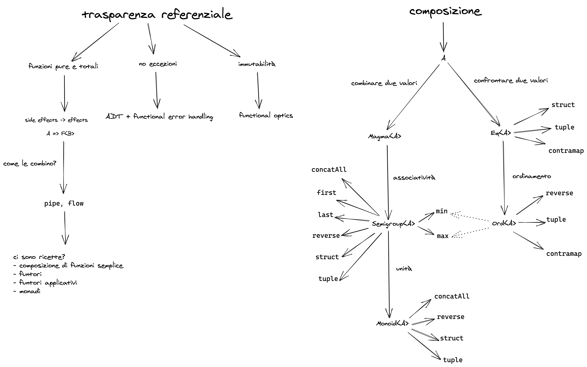

# Originalni prevod

Ovde se nalazi kompletan srpski prevod kursa funkcionalnog programiranja koji je napisao **Giulio Canti** ([gcanti](https://github.com/gcanti), autor biblioteke `fp-ts`). Original na italijanskom jeziku: [github.com/gcanti/functional-programming](https://github.com/gcanti/functional-programming).

Prevod je podeljen po poglavljima, ali je **tekst neizmenjen**. Promenjene su samo putanje do slika i izvornog koda i tri interne veze (sidra) između poglavlja, jer se poglavlja sada nalaze u posebnim fajlovima. Verzija u jednom fajlu dostupna je u git istoriji repozitorijuma (commit `262eec5`, fajl `README.md`).

Novi kurs (lekcije u celinama) nastaje preradom ovog materijala. Koje poglavlje je prerađeno i gde se nalazi opisano je u [mapi sadržaja](../mapa-sadrzaja.md).

## Napomena iz originalnog prevoda

> Ovo je prevod kursa na srpski jezik (latinica). Original na italijanskom: https://github.com/gcanti/functional-programming (autor: Giulio Canti).

**Note**.

- There is an adaptation written in english: https://github.com/enricopolanski/functional-programming
- 한글 번역본이 있습니다: https://github.com/alstn2468/functional-programming

## Poglavlja

| #   | Poglavlje                                                                                    | Status u novoj strukturi                                                                                   |
| --- | -------------------------------------------------------------------------------------------- | ---------------------------------------------------------------------------------------------------------- |
| 1   | [Šta je funkcionalno programiranje](01-sta-je-funkcionalno-programiranje.md)                 | Prerađeno u [Celini 1](../01-osnove/index.md)                                                              |
| 2   | [Dva stuba funkcionalnog programiranja](02-dva-stuba-funkcionalnog-programiranja.md)         | Prerađeno u [Celini 1](../01-osnove/index.md)                                                              |
| 3   | [Modelovanje kompozicije pomoću polugrupa](03-polugrupe.md)                                  | Planirano za [Celinu 3](../03-algebre/index.md)                                                            |
| 4   | [Modelovanje jednakosti pomoću `Eq`](04-jednakost-eq.md)                                     | Planirano za [Celinu 3](../03-algebre/index.md)                                                            |
| 5   | [Modelovanje uređenja pomoću `Ord`](05-uredjenje-ord.md)                                     | Planirano za [Celinu 3](../03-algebre/index.md)                                                            |
| 6   | [Modelovanje kompozicije pomoću monoida](06-monoidi.md)                                      | Planirano za [Celinu 3](../03-algebre/index.md)                                                            |
| 7   | [Čiste funkcije i parcijalne funkcije](07-ciste-i-parcijalne-funkcije.md)                    | Prerađeno u [Celini 1](../01-osnove/index.md)                                                              |
| 8   | [Algebarski tipovi podataka](08-algebarski-tipovi-podataka.md)                               | Planirano za [Celinu 2](../02-modelovanje/index.md)                                                        |
| 9   | [Funkcionalno rukovanje greškama](09-funkcionalno-rukovanje-greskama.md)                     | Planirano za [Celinu 2](../02-modelovanje/index.md) (instance `Eq`, `Semigroup` i `Monoid` za `Option` za [Celinu 3](../03-algebre/index.md)) |
| 10  | [Teorija kategorija](10-teorija-kategorija.md)                                               | Planirano za [Celinu 4](../04-apstrakcije/index.md); delovi korišćeni u Celini 1                           |
| 11  | [Funktori](11-funktori.md)                                                                   | Planirano za [Celinu 4](../04-apstrakcije/index.md); deo o efektima korišćen u Celini 1                    |
| 12  | [Aplikativni funktori](12-aplikativni-funktori.md)                                           | Planirano za [Celinu 4](../04-apstrakcije/index.md)                                                        |
| 13  | [Monade](13-monade.md)                                                                       | Planirano za [Celinu 5](../05-efekti/index.md)                                                             |

**Dodaci**

- A. [Monad transformeri](dodatak-monad-transformeri.md)
- B. [`Task` naspram `Promise`](dodatak-task-vs-promise.md)

## Mapa uma originalnog kursa

Mapa uma koju je autor napravio uz originalni kurs (na italijanskom). Levo je _trasparenza referenziale_ (referencijalna transparentnost) sa granama čiste i totalne funkcije, bez izuzetaka i nepromenljivost; desno je _composizione_ (kompozicija) sa algebarskim strukturama `Magma`, `Semigroup`, `Monoid`, `Eq` i `Ord`.

## Primeri i vežbe iz originala

Izvorni kod nalazi se u folderu [`src/`](../../src/) i nije menjan.

| Fajl                                                                     | Sadržaj                                                         |
| ------------------------------------------------------------------------ | --------------------------------------------------------------- |
| [`00_pipe_and_flow.ts`](../../src/00_pipe_and_flow.ts)                   | `pipe` i `flow` na jednostavnom primeru                          |
| [`01_retry.ts`](../../src/01_retry.ts)                                   | Modul sa primitivama i kombinatorima za politike ponavljanja    |
| [`02_ord.ts`](../../src/02_ord.ts)                                       | Polugrupa za `Ord<A>`                                           |
| [`03_shapes.ts`](../../src/03_shapes.ts)                                 | Crtanje geometrijskih oblika na canvas-u (monoidi), `npm run shapes` |
| [`04_functor.ts`](../../src/04_functor.ts)                               | Slike kao funktor, `npm run functor`                            |
| [`05_applicative.ts`](../../src/05_applicative.ts)                       | Bacanje kockica u igri uloga (aplikativni funktori)             |
| [`06_game.ts`](../../src/06_game.ts)                                     | Igra „Pogodi broj“ (monade, `Task`)                              |
| [`hangman.ts`](../../src/hangman.ts)                                     | Igra „Vešala“                                                   |
| [`laws.ts`](../../src/laws.ts)                                           | Testiranje zakona polugrupe pomoću `fast-check`                 |
| [`reader.ts`](../../src/reader.ts)                                       | `Reader` i ubrizgavanje zavisnosti                              |
| [`program6.ts`](../../src/program6.ts)                                   | Program sa efektom `ReaderTaskEither`                           |
| [`mutable-is-unsafe-in-typescript.ts`](../../src/mutable-is-unsafe-in-typescript.ts) | Zašto su promenljivi nizovi nebezbedni u TypeScript-u |
| [`onion-architecture/`](../../src/onion-architecture/)                   | Onion arhitektura u funkcionalnom stilu, u šest koraka          |
| [`exercises/`](../../src/exercises/) i [`solutions/`](../../src/solutions/) | Vežbe (Magma, Semigroup, Monoid, Eq, Ord, ADT, rukovanje greškama, Functor, Apply, Applicative, Monad) i rešenja |

## Autorstvo i licenca

Originalni kurs: Copyright (c) 2019-present Giulio Canti, objavljeno pod [MIT licencom](../../LICENSE). Ceo repozitorijum, uključujući prevod i preradu, nalazi se pod istom licencom.
